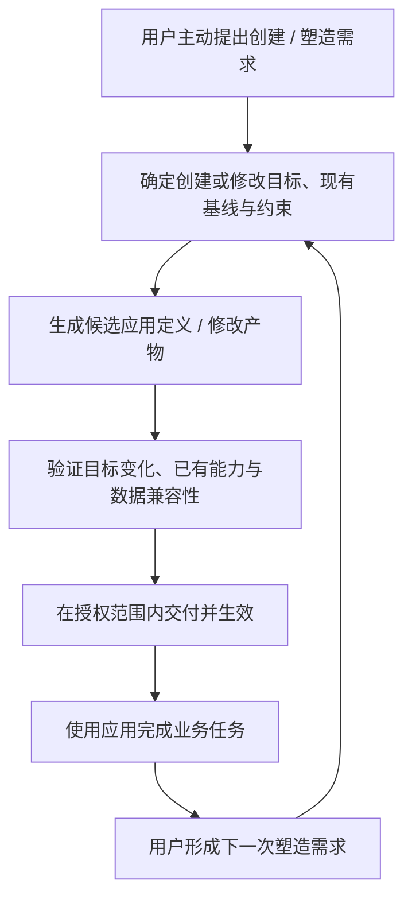

# Generative App 定义

> **状态：** Draft v0.5  
> **调研日期：** 2026-10-03（北京时间）  
> **定义修订日期：** 2026-10-04（北京时间）  
> **目的：** 定义生成式应用的生成对象、持续性、演化机制与判断标准，作为产品讨论和架构设计的共同语言。  
> **范围：** 单个应用；多应用平台的产品与技术方案见 [Generative App Platform](./generative-app-platform.md)。

本文沿用项目中的 **Generative App（生成式应用）** 命名。外部资料对 Generative UI、generative AI applications、AI app building 的用法并不相同；本文提出的完整定义与最低条件是**本项目的工作约定**，不声称是统一行业标准，也不表示仓库已经实现这些能力。

## 1. 核心定义

> **Generative App 是一种能持久运行，并支持用户在持续使用中通过 AI 主动塑造的完整应用。用户通过应用或平台提供的塑造入口表达需求，让 AI 修改应用的结构与行为，使变化成为可重复使用的能力，同时延续应用身份、已有数据与工作上下文。**

**“塑造应用”是使用者可调用的产品能力。** 仅有开发团队在后台使用 AI 编程或维护应用，不足以满足这一定义；使用者应当拥有从表达修改需求到获得可继续使用的应用结果的产品路径。

用户主动塑造的范围包括数据结构、业务规则、工作流与界面，也可以涉及能力连接。一项需求可以同时改变多个部分，使它们共同实现新的工作方式。生成可以通过代码、声明式描述或已有能力的组合实现，不要求每一部分都从零生成。

概念的重心是：**让用户在使用软件的过程中，持续塑造适合自己工作方式的软件。** 应用可以由 AI 根据意图从零创建，也可以从已有应用演进而来；最初由人开发的应用，在具备本文要求的持续塑造能力后，同样可以成为 Generative App。**用户主动塑造是核心能力，应用主动提出改进建议是增强能力。** AI 首次生成是重要的创建方式，生成式演化是必要的核心机制。

一句话版本：

> **让用户通过 AI，在持续使用中塑造适合自己工作方式的应用。**

英文工作定义：

> A generative app is a complete, persistent application that exposes AI-driven shaping to its users as a product capability through the app or its platform. AI turns explicit user requests into reusable changes to the application's structure and behavior while preserving its identity, relevant data, and work context. Its first version may be AI-generated or human-developed. User-initiated shaping is a core capability; proactive suggestions from the app are an optional enhancement.

这个定义有三个相互依赖的部分：

1. **生成应用定义。** AI 根据用户需求实质生成或修改应用的结构与行为，形成可以实际使用的软件能力；生成可以发生在新应用的创建阶段，也可以发生在已有应用的演化阶段。
2. **持续使用。** 应用在一次使用或塑造会话结束后仍然存在，用户能够再次打开它并延续相关工作。
3. **用户主动塑造。** 应用或平台将塑造能力作为产品能力提供给使用者；用户在使用中提出改变应用工作方式的需求时，AI 能在已有应用及其约束上继续生成修改，并把修改交付为可重复使用的能力。生成式演化是实现这一能力的机制。

“使用—用户提出塑造需求—生成修改—再使用”构成核心闭环。从零生成新应用与为已有应用建立持续塑造机制，是进入这一闭环的两种路径。只有首轮生成，没有可重复的后续演化路径，应称为 AI-generated app；只有持续运行，没有 AI 对应用结构与行为的生成机制，也不足以符合本文定义。

### 1.1 为什么采用 Generative App

**Generative App** 表达应用的形成与演化机制：生成对象是应用自身的结构与行为，生成过程既可以创建第一个版本，也可以依据后续需求生成已有应用的修改。完整应用是交付与演化的单元。

在这个定义中，持续演化是生成机制在交付后作用于同一个应用的结果。第一版可以由 AI 或人创建，后续针对用户需求的修改通过 AI 生成；已有应用身份、业务数据和工作上下文按声明的兼容边界延续。因而，Generative 描述应用在使用期间持续生成结构与行为变化的能力，也可以覆盖首次构建。

这也是本文保留该名称的理由：

- **生成对象明确：** 从 Generative UI 的界面与交互层扩展到完整 App 的结构、行为与交付边界。
- **生成机制持续适用：** 创建新应用、扩展能力、重组工作流和修改业务逻辑，都可以使用同一生成机制。
- **演化机制有区分度：** Evolvable App 强调能够演化，Generative App 进一步说明 AI 生成是实现创建与演化的机制；“可演化”可以描述它的属性，无须替代核心名称。
- **能力主次明确：** 用户主动请求塑造应用是核心能力；应用主动建议与获授权的自动更新是可选增强，不要求 Self-Evolving 所容易暗示的自主发起与自动改写。

以上是本文的命名理由，而非断言英文单词 generative 天然包含持久运行和版本治理等全部要求。具体成立条件仍由本文定义。

生成机制可以由平台或外部构建引擎提供，但塑造能力仍须通过应用或平台面向使用者提供。不要求每个 App 内置模型、自己修改源码或在每次业务操作时重新生成。它可以在使用期间稳定运行，并在有新需求时生成下一版本。

正式写法采用 **Generative App**（单个应用）、**Generative Apps**（应用类别或集合）与 **Generative App Platform**（承载平台及本项目名称），中文分别为“生成式应用”与“生成式应用平台”。本项目的完整技术定位为 **Agent-native Generative App Platform**；Agent-native 描述协作属性，在副标题和技术介绍中使用。

### 1.2 与 Generative AI App、AI-generated App 的区分

三个名称关注不同维度，不能作为同义词互换：

| 名称 | 主要描述什么 | 生成对象或判断依据 | 名称本身不保证什么 |
|---|---|---|---|
| **Generative AI App（使用生成式 AI 的应用）** | 应用提供的 AI 功能 | 使用生成式模型产生文章、图像、摘要或其他结果 | 不保证应用结构与工作流也能根据需求生成和演化 |
| **AI-generated App（AI 生成的应用）** | 应用的生产来源 | AI 参与创建应用的代码、配置或其他产物 | 不保证完整交付、持久运行和可重复的生成式演化 |
| **Generative App（本文定义的生成式应用）** | 使用者可调用的生成式塑造能力 | 用户通过应用或平台的产品入口提出需求，由 AI 持续修改完整应用的结构和行为；首次由谁创建不影响判定 | 不自动保证主动建议、自主更新、Agent-native 协作或每次使用都生成界面 |

AWS 对 generative AI applications 的介绍包含使用基础模型的聊天机器人和摘要工具，支持上表对该用法的区分；它没有提出本文的 Generative App 定义。[AWS：Best practices to build generative AI applications](https://aws.amazon.com/blogs/machine-learning/best-practices-to-build-generative-ai-applications-on-aws/)

这三个维度可以重叠。一个由 AI 创建、内置文章生成能力，并能持续生成工作流修改的写作 App，可以同时满足三个描述。一个由 AI 创建、日常只执行确定性规则的记账 App，也可以满足本文定义，只要它具备完整交付、持久上下文和可重复的生成式更新路径。

**AI-generated 不等于只能生成一次。** AI 可以参与首轮构建，也可以参与后续升级；这一名称只表达生产来源，单独使用时并不保证持续演化闭环。Generative AI App 也可以具备应用演化能力，只是“提供生成式 AI 功能”这一事实不足以证明它。

以公众号写作为例：

- “生成一篇文章”体现应用的生成式 AI 功能。
- “由 AI 写出了这个写作工具”体现应用的 AI 生产来源。
- “根据用户的写作需求创建工作台，并在保留文章和项目上下文的基础上，继续生成引用检查、选题流程等应用能力”体现本文的 Generative App 机制。

对外说明可以使用：**Generative App：由意图驱动，在使用中塑造。** 该表达强调用户在使用过程中主动改变应用的能力，不限定首次创建方式，也不表示默认采集行为或自动安装更新。

## 2. 调研依据与术语现状

### 2.1 “使用生成式 AI 的应用”与“应用本身被生成”是两个问题

AWS 的官方材料将聊天机器人、摘要工具等使用基础模型的产品称为 generative AI applications，关注模型、Prompt、RAG 和模型定制。这里描述的是**应用内部使用生成式 AI**；不应把 generative AI applications 直接等同于本文的 Generative App，也不能据此认为 AWS 已采用本文的概念定义。[AWS：Best practices to build generative AI applications](https://aws.amazon.com/blogs/machine-learning/best-practices-to-build-generative-ai-applications-on-aws/)

因此，本文使用 Generative App 时，特指应用的产生与演化机制。一个界面和工作流预先固定的 AI 写作工具，可能是生成式 AI 应用，但不能仅凭它会生成文章，就归入本文的 Generative App。

### 2.2 Generative UI 可以覆盖完整交互体验

Google Research 在 2025 年的 Generative UI 工作中，让模型生成 HTML、CSS、JavaScript 与相关资源，交付针对 Prompt 定制的交互网页、工具、游戏等体验。其论文也明确涉及交互式、数据驱动的 web applications。因此，不能把 Generative UI 一概限定为固定组件选择、静态页面或没有业务行为的界面。[Google Research 官方介绍](https://research.google/blog/generative-ui-a-rich-custom-visual-interactive-user-experience-for-any-prompt/)、[论文原文 §2、§5](https://generativeui.github.io/static/pdfs/paper.pdf)

该论文主要评估生成结果的人类偏好，评测没有计入生成时间，并讨论了生成延迟与代码错误。它为交互体验生成提供了证据，**并未替本文验证应用的长期运行、数据迁移和持续交付能力**；后者是本文根据项目目标增加的要求。[论文原文 §3、§6](https://generativeui.github.io/static/pdfs/paper.pdf)

### 2.3 组件组合与事件协议承担不同职责

另一条 Generative UI 路径是组合已有组件。Vercel AI SDK 的官方示例把工具调用结果映射到开发者实现的 React 组件，并放在聊天界面中动态显示；这同样被其文档称为 Generative UI。[AI SDK：Generative User Interfaces](https://ai-sdk.dev/docs/ai-sdk-ui/generative-user-interfaces)

因此，固定的聊天外壳不排除界面生成，使用组件库也不排除生成式应用。几个相关项目提供的契约各有侧重：

| 项目 | 一手材料描述的职责 |
|---|---|
| [A2UI](https://a2ui.org/concepts/overview/) | 发送声明式 UI 结构与数据，由客户端渲染，支持 Surface 增量更新 |
| [OpenUI](https://www.openui.com/docs) | 根据应用定义的组件库选择、配置和组合界面，并流式渲染 |
| [AG-UI](https://docs.ag-ui.com/concepts/events) | 在 Agent 与前端之间传输消息、工具调用、Agent run 生命周期及状态同步事件 |

**本文归纳：** 这些契约可以参与应用实现，但采用某个 UI 格式或事件协议，本身不证明应用已经具备长期存储、授权执行、版本升级和数据迁移。AG-UI 的 Agent run 生命周期与本文的 App 生命周期也属于不同对象。

### 2.4 使用中生成新能力已有研究探索

Google 的 2026 年 Self-Evolving Systems 研究区分了用户直接要求生成、从需求推断生成，以及运行时界面适应，并使用银行应用功能原型进行可用性研究。该工作说明“软件随用户需要改变”已有明确研究表达，但它的原型研究不能直接证明长期生产环境中的可靠演化。本文据此把**动态适应**与**持久、受控的应用演化**分开讨论。[Google Research 论文页面](https://research.google/pubs/self-evolving-systems-moving-beyond-deterministic-interfaces-to-adaptive-generative-interfaces/)、[论文原文 §3–§6](https://storage.googleapis.com/gweb-research2023-media/pubtools/1034946.pdf)

### 2.5 AI 构建工具已覆盖应用发布与后续更新

Replit Agent 的官方文档描述了代码生成、基础设施配置、测试和后续改进；发布文档说明部署独立应用实例，并通过再次发布更新线上版本。Lovable Cloud 提供数据库、鉴权、存储等后台能力，其发布文档也区分编辑中的项目与已发布快照。[Replit Agent](https://docs.replit.com/features/agent/overview)、[Replit Publishing](https://docs.replit.com/learn/projects-and-artifacts/replit-deployments)、[Lovable Cloud](https://docs.lovable.dev/features/cloud)、[Lovable Publish](https://docs.lovable.dev/features/publish)

这提供了不能将 AI coding 简化为“一次性代码生成”的具体反例。上述产品构建的某个应用，若实际满足本文最低条件，可以属于 Generative App；产品功能介绍并不等于其所有产物都已通过条件验证。

Replit 还明确区分代码回退与数据库恢复：默认回滚不改变数据库，生产数据库需要单独处理。本文据此要求说明恢复边界，而不承诺生成式更新天然能够无损撤销。[Replit：Checkpoints and Rollbacks](https://docs.replit.com/features/version-control/checkpoints-and-rollbacks)

以上是来源事实与本文归纳的区分：外部材料支持生成界面、交互体验、适应机制，以及应用构建和后续发布的实践；“持久应用身份 + 完整交付 + 可重复演化”的组合是本项目选定的概念边界。本次调研未找到对这一组合的统一跨项目规范，这不等于断言相关规范绝对不存在。

## 3. 定义中的关键词

### 3.1 用户意图

用户意图描述希望完成什么工作，以及工作需要遵守的约束，例如“维护公众号选题、文章草稿和发布前检查”。它可以来自自然语言、已有资料、示例、界面操作或结构化要求，不限定为一句 Prompt。

使用反馈可以包含用户纠正、任务失败、重复操作和经授权采集的使用证据。反馈是修改的依据，不是扩大数据访问或执行权限的授权。用户也可以直接要求新增功能，不必等系统积累行为数据。

### 3.2 生成

生成发生在**应用定义**上：它改变应用可以怎样工作，而不只是改变本次工作输出。

| 用户请求 | 变化对象 | 本文分类 |
|---|---|---|
| “写一篇文章” | 一篇业务内容 | 内容生成 |
| “把这篇文章标记为已审阅” | 一个业务对象的状态 | 业务操作 |
| “把当前数据画成柱状图” | 当前任务的呈现方式 | 界面或任务结果生成；不单独证明应用演化 |
| “以后每篇文章发布前都检查引用和封面” | 可重复使用的工作流与规则 | 应用演化 |
| “做一个维护选题、草稿和检查记录的工具” | 一个新应用的结构与行为 | 应用创建 |

生成可以表现为新代码，也可以表现为新表单结构、领域 schema、工作流描述和能力组合。是否采用已有组件、模板或托管服务，不决定是否属于生成式应用；关键是 AI 是否根据需求实质产生或修改了可持续使用的应用结构与行为。

只换标题、颜色或填入固定模板的内容，不能单独证明生成了应用。若生成的图表随后被保存为同一个应用中的可复用视图，并具有后续修改路径，它也可以成为应用演化的一部分。

### 3.3 完整应用

“完整”表示能完成其**声明范围内的核心任务**，不表示功能庞大或已经支持所有潜在需求。

例如，只负责文章草稿管理的 App，能够保存、查找和继续编辑草稿，就可以是范围完整的小应用；它不必同时支持排版、公众号发布、团队权限和商业分析。若声称支持发布，则发布能力、授权和结果确认也属于交付范围。

应用可以复用平台数据库、现成 API 和外部业务服务，不必拥有独立服务器或数据库。完整性按端到端结果判断，而不是按自行生成了多少代码判断。

### 3.4 持久运行

持久性至少包括：

- **应用身份延续：** 下次打开的是同一个应用，而非根据旧 Prompt 重新猜出一个相似工具。
- **应用定义延续：** 已交付的结构、行为和运行配置能够恢复。
- **任务相关状态延续：** 声明保存的业务数据、项目和工作进度可以跨会话继续。

它不要求进程全天驻留，也不要求数据库一定在本地。按需启动、离线运行或连接外部事实源都可以成立。应用确实无须保存业务状态时，可以声明无状态，但不能因此省略应用身份和定义的持续性。

### 3.5 持续演化

持续演化表示**交付后仍有可重复执行的生成与更新机制**，不表示软件每时每刻都在自我改写。

一个版本可以稳定运行很久；只有新需求出现时才生成下一版本。支持用户主动提出修改需求是核心能力；应用从使用证据中发现机会、主动提出建议，以及在授权范围内自动安装更新，都是增强能力。

演化还必须说明哪些变化能够延续原应用的数据和上下文。相同入口下静默替换为不兼容的新工具，或每次重新生成并丢弃旧数据，不能证明同一个应用得到持续改进。

### 3.6 用户主动塑造与应用主动建议

**用户主动塑造**是指用户在使用应用时，主动表达希望应用以后怎样工作，AI 将需求转化为同一应用的结构或行为变化。例如，“以后每篇文章发布前都检查引用”，改变的是后续可重复执行的工作流程；“检查这篇文章的引用”则是在执行当前业务任务。

塑造入口可以由应用或平台提供，用户通过它指定要改变的应用、表达需求，并获得应用变更及交付结果。入口不限定为内置聊天框，后续流程也可以包含人工检查或协助；关键是生成式塑造作为产品能力向使用者开放，并有可重复的实现与交付路径。

反馈表单或需求工单本身不能证明这项能力。如果用户只能提交一般反馈，后续由开发团队按开发计划决定如何修改，而 AI 只是开发团队内部使用的工具，则尚未证明使用者能够调用生成式塑造能力。

**应用主动建议**是指应用依据经授权的使用反馈发现可能的改进机会，向用户提出改变应用的建议。例如，“你经常手动检查引用，是否要加入发布前流程？”用户采纳后，建议可以转为塑造需求，再进入同一生成与交付路径。提出建议本身不表示应用已经改变。

| 能力 | 在本概念中的位置 | 判断依据 |
|---|---|---|
| 用户主动塑造 | 核心能力 | 用户提出修改需求后，AI 能将其交付为同一应用中可重复使用的能力 |
| 应用主动建议 | 增强能力 | 应用可以发现并解释改进机会，供用户决定是否采纳 |

谁发起需求与修改怎样生效是两个独立问题。用户主动提出的需求可以在已有授权范围内自动交付；应用主动提出建议也不意味着可以自动安装。核心能力的验证不依赖应用先积累使用记录或主动发现问题。

## 4. 生成对象与应用边界

### 4.1 生成边界覆盖应用，而非只覆盖呈现

**数据结构、业务规则、工作流和界面都属于用户主动塑造的核心范围。** 当一项需求涉及多个部分时，生成与交付应保持这些部分一致，使新的工作方式能够实际执行。具体应用应声明支持的塑造范围，核心范围并不表示每个应用都必须包含全部对象，或支持任意修改。

| 对象 | 可能生成或修改的内容 | 应保持明确的边界 |
|---|---|---|
| 界面与交互 | 页面、视图、编辑器、交互规则 | 界面变化不能静默丢失正在处理的工作 |
| 业务数据模型 | 对象、字段、关系、校验与存储映射 | 模型与真实业务记录是不同对象 |
| 业务逻辑 | 计算、状态转换、领域规则 | 执行时仍须满足业务约束 |
| 工作流 | 步骤、条件、分支、人工介入点 | 执行既有流程与修改流程定义应可区分 |
| 能力连接 | 查询、编辑、导出、发布等服务的连接方式 | 能生成调用代码不等于已经获得权限 |
| 交付与运行配置 | 应用产物、依赖、入口、兼容信息 | 生成源码不自动等于可运行版本 |

这里列出的是**生成与管理可能覆盖的范围**，不是要求每个 App 都生成所有对象。共享的可靠模块可以直接复用；生成业务逻辑也不意味着每次业务操作都要让模型临时写代码。

“生成业务数据”在本文中主要指生成数据模型和处理机制。示例数据须标明为示例；真实客户记录、文章、订单和账户余额必须来自用户输入或获授权的事实源。生成内容可以成为业务数据，但不能冒充已经发生的业务事实。

### 4.2 App、Surface 与 Component

沿用 [项目术语表](../../GLOSSARY.md)：

```text
App：具有持续身份的业务或工作上下文
└── Surface：其中面向具体任务的工作界面
    └── Component：界面的交互单元
```

公众号写作 App 可以包含选题列表、文章编辑器和发布检查三个 Surface；增加一个 Surface 通常是在演化同一个 App，而不是新建三个 App。

判断新 App 还是原 App 的新版本，应看它是否具有独立的任务范围、身份、进入与管理需求，而不是页面数量。身份延续也不要求名字永远不变；重命名与复制为新 App 是不同操作。

### 4.3 一项需求如何改变多个部分

假设一个写作 App 已有文章管理和发布能力，用户在使用中提出：“给文章增加审核人，并要求审核通过后才能发布。”这次塑造需要协调以下变化：

| 部分 | 需要形成的能力 |
|---|---|
| 数据结构 | 保存文章的审核人、审核状态及必要的审核记录 |
| 业务规则 | 发布操作检查审核结果，未通过审核的文章无法发布 |
| 工作流 | 将提交审核、审核处理和发布衔接起来 |
| 界面 | 提供选择审核人、处理待审核文章、查看审核状态的操作入口 |

用户可以表达完整的工作需求，由 AI 将其落实到这些部分。交付后的审核状态、发布规则、流程和界面应当一致；已有文章及工作进度需要延续，其审核初始状态和兼容方式也应明确。

这个例子的验收重点是：审核信息可以保存并再次读取，未通过审核时发布操作会被阻止，通过审核后可在原有发布权限内继续发布，原有文章仍然能够使用。仅出现新的审核字段或按钮，还不足以完成这项需求。这是跨多个部分塑造应用的示例，不要求每个 Generative App 都具有审核或发布功能。

## 5. 最低成立条件

下面五项是本文的最低判断条件。应针对具体应用及其声明范围验证，不能仅凭 Builder 的演示效果给所有产物贴上标签。

| 编号 | 条件 | 应能观察到的证据 |
|---|---|---|
| G1 | 意图驱动的应用定义生成 | 可以关联用户需求与 AI 生成结果，并看到应用结构或行为的实质变化；可以发生在新应用创建时或已有应用演化时 |
| G2 | 范围完整的可用交付 | 用户能在实际运行环境完成声明的核心任务，相关数据与能力已接通 |
| G3 | 跨会话持续性 | 结束使用或塑造会话后仍能再次使用同一应用，恢复声明保留的定义与相关状态 |
| G4 | 使用者可调用、可重复的生成式塑造 | 交付后，用户能通过应用或平台提供的产品入口针对同一应用提出修改需求，由 AI 生成并交付可重复使用的能力；这一路径能再次调用，不依赖应用主动建议 |
| G5 | 可检查、受控的版本交付 | 能识别使用中的应用定义与变更产物，检查变化，并依据授权与兼容规则生效 |

G1–G5 全部成立，才符合本文的 Generative App。G5 中“版本”可以是代码版本，也可以是声明式配置版本；不要求一定使用 Git、语义化版本号或某个平台的安装机制。

G1 判断是否通过 AI 实质生成或修改了应用定义，G4 判断用户是否拥有可重复的塑造路径。最初由人开发的应用可以通过后续的生成式修改提供 G1 的证据，不需要重新由 AI 生成整个应用。

G4 不能仅靠“有源码，理论上可以请 AI 再改”或“开发团队持续使用 AI 维护”来证明。应有面向使用者、已声明且可以重复调用的塑造入口及构建与交付路径，并至少用一次交付后修改验证它。外部 AI 编程工具和现有部署服务可以承担后台实现，不要求专用平台或内置 Builder；无论采用哪种实现，塑造都须作为产品能力提供给使用者。

### 条件性工程要求

应用支持以下变化或操作时，必须处理相应问题；这些要求来自本项目的可靠交付目标，不能用协议名称代替实现证据。

- **修改持久化模型时：** 检查兼容性，明确迁移、备份和失败处理；无法迁移的变化应被阻止或明确要求另建应用。
- **涉及权限或外部副作用时：** 由运行系统强制检查授权和允许效果；修改界面或生成代码不能扩大原有权限。
- **并发编辑或在用升级时：** 检查变更基线与当前状态，避免静默覆盖后续修改或未保存工作。
- **安装或运行失败时：** 明确报告实际状态；保留原版本、恢复、补偿或重新修复的路径及限制。
- **根据使用记录演化时：** 明确采集与使用范围，允许用户控制；业务记录中的文字不能成为执行或修改授权。

**恢复旧代码不等于恢复旧数据，也不等于撤销外部发布。** 不能把“支持版本回退”宣传为无条件撤销所有效果。

## 6. 与相邻概念的关系

| 概念 | 主要回答的问题 | 与 Generative App 的关系 |
|---|---|---|
| AI-powered app | 应用是否使用 AI 提供能力？ | 范围也包括分类、预测等非生成能力；不必生成或演化应用本身 |
| Generative AI App | 应用是否使用生成式 AI 提供内容或结果？ | 描述功能；可以与本文概念重叠，参见 1.2 节 |
| AI-generated App | 应用是否由 AI 参与创建？ | 描述生产来源；可以重复升级，但不单独证明持续演化，参见 1.2 节 |
| Generative UI | AI 如何生成适合当前意图的界面与交互？ | 可以构成应用的交互层，也可能覆盖应用级体验；不能仅凭名称判断生命周期 |
| AI app builder | 怎样构建和修改应用？ | 是生产应用的工具或过程，产物需分别验证 |
| AI 辅助编程 / vibe coding | 人如何与 AI 协作编写软件？ | 是开发方式；可以产生完整 Generative App，也可以产生普通软件或原型 |
| Adaptive UI | 界面怎样适应用户与环境？ | 可以由预设规则实现；适应本身不证明生成式应用演化 |
| Agent-native | Agent 怎样理解、获准操作并验证软件？ | 是独立的协作属性；由 AI 创建的 App 不自动符合 |
| Generative App Platform | 多个应用怎样被构建、交付、发现和管理？ | 是承载环境，单个应用可以独立存在 |

### 6.1 与 Generative UI 的区别在管理边界

本文区分的重点是：生成出的体验是否形成了**有持续身份、可重复使用、可继续演化的应用**。它不以“固定组件还是自由代码”“一页还是多页”“有没有状态”作为简单分界线。

一个即时生成的模拟器，可以是优秀的 Generative UI，也可能已经是功能完整的交互应用；若尚未具备 G3–G5，则仍不能按本文定义声称是 Generative App。反过来，一个使用期间界面稳定、只在用户提出新需求时更新的应用，可以符合本文定义。

### 6.2 与 Agent-native 是两个维度

| | 尚未满足 Agent-native 契约 | 满足 Agent-native 契约 |
|---|---|---|
| 尚未满足 Generative App 条件 | 固定应用，无完整 Agent 协作契约 | 固定应用，提供明确的上下文、能力、授权与结果契约 |
| 满足 Generative App 条件 | 能生成并持续演化，但 Agent 日常操作仍缺少明确契约 | 能生成并演化，也支持 Agent 在声明范围内可靠协作 |

本项目选择右下角作为产品目标。通用 Generative App 定义并不要求 Agent-native；后者的具体判定见 [Agent-native 定义](./agent-native.md)。

### 6.3 与 AI 编程工具和平台的关系

AI 编程工具能够构建应用、持久化、部署流程和更新机制。不能把 Generative App 的价值建立在“其他工具只能生成代码或一次性页面”的假设上。

Builder 描述生产机制，App 描述交付后可持续使用的对象，Platform 描述多个对象的承载与管理。它们可以出现在同一个产品里，但不能互相代替。

判断某个应用是否符合本概念，需要查看它的使用者能否通过应用或平台调用生成式塑造能力，并获得同一应用的可用更新。仅证明开发者使用 AI 构建或维护该应用，不足以满足这一要求。开发者与使用者可以是同一个人，判定依据仍是可调用的产品能力及其交付证据。

平台的增量价值应通过完整使用周期验证：首次交付后能否再次使用，修改能否保留业务上下文，共性服务能否复用，以及维护成本是否下降。单个应用不需要多 App Router、应用市场或跨应用共享能力，才能符合本文定义。

## 7. 创建、业务使用与应用演化

### 7.1 三种操作需要不同的目标和授权

以公众号写作 App 为例：

| 操作类型 | 用户请求 | 目标与结果 |
|---|---|---|
| 创建应用 | “做一个公众号写作工作台” | 生成新 App 的定义与可用版本 |
| 使用应用 | “精简当前文章的第二段” | 修改该文章的指定内容，应用定义通常不变 |
| 演化应用 | “以后加入发布前引用检查” | 修改同一个 App 的工作流与交互，形成新的应用版本 |

业务操作权限不自动包含修改应用的权限；构建应用的权限也不自动包含发布文章的权限。用户请求不明确时，应先确定变化对象，再进入相应流程。

### 7.2 演化的参考过程



这是责任划分，不规定必须有七个可见按钮。代码生成与部署、声明式 schema 更新、受控的运行时生成都可以实现它。低风险且已授权的变化可以自动生效；需要用户决定时，批准应绑定具体修改内容与效果。

### 7.3 三种实现方式

- **构建时生成：** 生成代码和配置，验证后交付版本；使用期间按该版本稳定运行。
- **运行时生成：** 在任务执行期间生成界面或行为；希望成为应用长期能力时，仍需处理定义保存、权限与后续使用。
- **混合方式：** 稳定的应用核心负责状态与业务规则，动态生成视图或能力组合；被接受的修改进入可管理的应用定义。

这些是实现选项，不是从低到高的成熟度排名。模型持续在线、自我修改源码和完全自动安装，都不是统一必要条件。

## 8. 判断测试与边界案例

### 8.1 最小验证场景

可以从两种起点进行验证：让 AI 根据需求创建一个能保存选题和文章草稿的公众号写作工具，或使用一个已有同等能力的应用，为其建立用户通过 AI 主动塑造的机制。无论首次创建方式如何，都验证以下过程：

1. 完成一次真实工作：新增选题、保存一篇草稿、再次读取，确认产物实现了声明的任务范围。
2. 结束当前会话并重新进入：确认同一应用身份、定义和已保存内容仍然存在。
3. 由应用使用者通过应用或平台提供的塑造入口提出新需求：“加入发布前引用检查，并保留已有文章。”检查修改是否针对已有应用，而非重新生成替代品。
4. 验证候选修改：新检查流程能够工作，旧的保存与读取能力继续成立，数据变化有兼容处理。
5. 让更新生效后再次使用：确认当前版本、旧数据与新能力可以共同运行，失败时的处理路径与限制可检查。

这些步骤共同提供 G1–G5 的证据：第 1 步验证可用交付，第 2 步验证跨会话持续性，第 3–5 步验证意图驱动的应用定义生成、用户主动塑造路径及受控交付。后续需求应能重复使用同一路径。若应用还声明 Agent-native，则另行验证 Agent 的上下文、能力发现、授权、执行与结果契约。以上是定义的验收方法，不是对当前仓库的测试结果。

验证核心能力时，不要求系统先主动发现改进机会。即使没有启用应用主动建议，用户也应能完成上述闭环；若提供主动建议，再单独验证建议依据、用户采纳以及后续交付过程。

### 8.2 边界案例

| 案例 | 按本文定义的判定 |
|---|---|
| 固定聊天应用调用模型生成文章 | 只证明 AI-powered，未证明应用生成与演化 |
| Agent 根据工具结果展示一个临时卡片 | 可以是 Generative UI，不单独证明 Generative App |
| AI 生成了一套源码，尚未运行核心任务 | 应用候选产物，未满足 G2 |
| AI 生成并部署了应用，之后没有可重复的生成式更新路径 | AI-generated app，未满足 G4 |
| 最初由人开发，后来支持用户通过 AI 持续塑造，并满足五项条件 | 可以符合；首次创建方式不是必要条件 |
| 人工开发的应用仅接入聊天助手，助手只能处理业务内容，不能改变应用定义 | 未满足 G1 和 G4；接入 AI 本身不足以成立 |
| 开发团队持续用 AI 维护，但使用者没有可调用的塑造入口及交付路径 | 未满足 G4；开发方式本身不足以证明产品能力 |
| 应用没有内置 Builder，但使用者能通过平台入口塑造同一应用并获得可用更新 | 可以符合；塑造入口不必内置于每个应用 |
| 应用可再次打开，但每次更新都会丢弃声明保留的数据 | 未满足持续性与受控演化要求 |
| 用已有组件和服务组合出可持续使用、可继续修改的专用工作台 | 可以符合，不要求自由代码生成 |
| 外部 AI 编程工具配合既有运行服务，向使用者提供可调用的塑造能力，并实现五项条件 | 可以符合，不要求本项目平台 |
| 只切换预设主题或填写固定模板参数 | 单独看不足以证明 G1 或 G4 |
| 无图形界面的专用任务应用，有持续身份和生成式更新机制 | 可以符合；UI 是可能的生成对象，不是唯一交付形式 |
| 每次重新生成不同网页，没有稳定身份或保存机制 | 未满足 G3 |
| 版本保持稳定，用户有需要时才请求 AI 更新 | 可以符合，不要求高频或自主演化 |
| 能根据使用记录建议新功能，但不能承接用户主动提出的应用修改需求 | 只有主动建议，不满足 G4 的核心能力要求 |

## 9. 设计原则与评价方式

以下是实现建议，不增加统一必要技术栈：

- **意图明确，产物可查。** 保留需求、现有基线、修改产物和验证结果的关联，便于解释为什么改变。
- **定义与业务状态分开。** 应用变更、业务数据变化和外部效果分别处理，避免把整体重生成当作数据恢复。
- **稳定性也属于价值。** 用户可以继续使用已接受版本，明确选择是否采纳会改变工作方式的建议。
- **按风险验证。** 既验证本次应该改变的行为，也验证应当保留的能力、权限和失败处理。
- **用户主动塑造优先。** 先保证用户提出需求后能够持续改变应用；主动建议作为增强能力，需求发起与更新生效分别声明范围。
- **退出边界可说明。** 清楚说明源码、配置、数据可否导出，离开平台后哪些能力还能运行。

评价不能只看“第一个页面生成得多快”。建议记录完整任务完成率、跨会话恢复成功率、后续变更成功率、数据保全与恢复结果、用户介入次数、总耗时与运行成本，并与同一需求的现有开发和部署路径比较。

持续演化是能力，改进是效果。新版本并不天然优于旧版本；是否更好应由真实任务表现与用户反馈判断。

## 10. 与本项目的衔接

[平台方案](./generative-app-platform.md) 已确定先交付基于 Pi 的 Coding 工作区，再通过它构建自媒体工作区。这是项目的自举与验证路径，不是所有 Generative App 的必要构成。

相关文档的职责分别是：

- **本文：** 定义单个 Generative App 的概念、边界与最低成立条件。
- **平台方案：** 说明本产品怎样承载多个 App，以及 Builder、Runtime、Registry、Router 等模块的位置。
- **[Agent-native 定义](./agent-native.md)：** 说明应用怎样在明确范围内为 Agent 提供可靠协作契约。

Pi、AG-UI、Cordis、React 或特定组件库是实现选择，不应写进 Generative App 的通用定义。平台要求的安装、路由等形式，可以实现本文的交付与管理目标，但通用定义允许其他等效方式。

## 11. 来源与阅读范围

本次调研使用一手资料。外部来源支持其各自描述的机制与实践；G1–G5 和条件性工程要求由本文提出，不能视为这些来源对本项目全部约定的背书。

动态文档均于上述调研日期核读；正文未标注日期的，表中不以搜索抓取时间代替发布时间。本文没有实测外部产品的生成质量、可靠性与成本，也不把项目自述的 “standard” 或 “production-ready” 当作独立认证。

| 来源 | 日期 | 本文使用范围 |
|---|---|---|
| [AWS：Best practices to build generative AI applications](https://aws.amazon.com/blogs/machine-learning/best-practices-to-build-generative-ai-applications-on-aws/) | 2024-03-14 | 区分使用生成式 AI 的应用与应用本身的生成 |
| [Google Research：Generative UI 官方介绍](https://research.google/blog/generative-ui-a-rich-custom-visual-interactive-user-experience-for-any-prompt/) | 2025-11-18 | 自由生成交互体验与工具的第一方实践 |
| [Generative UI: LLMs are Effective UI Generators](https://generativeui.github.io/static/pdfs/paper.pdf) | 随上述 2025 年材料发布；PDF 标为 preprint | 生成对象、评测范围与延迟、错误等限制 |
| [Vercel AI SDK：Generative User Interfaces](https://ai-sdk.dev/docs/ai-sdk-ui/generative-user-interfaces) | 正文未标注 | 工具结果映射预设组件的 Generative UI 路径 |
| [A2UI：Core Concepts](https://a2ui.org/concepts/overview/) | 正文未标注 | 声明式界面、数据与 Surface 更新 |
| [OpenUI：Introduction](https://www.openui.com/docs) | 正文未标注 | 应用组件库的选择、配置与组合 |
| [AG-UI：Events](https://docs.ag-ui.com/concepts/events) | 正文未标注 | Agent 与前端的事件及状态同步，Agent run 生命周期 |
| [Self-Evolving Systems 论文页面](https://research.google/pubs/self-evolving-systems-moving-beyond-deterministic-interfaces-to-adaptive-generative-interfaces/)及[原文](https://storage.googleapis.com/gweb-research2023-media/pubtools/1034946.pdf) | 页面标注 2026，未列具体日期 | 用户指令驱动的生成、推断生成与实时适应；原型研究的范围 |
| [Replit：Agent](https://docs.replit.com/features/agent/overview)及[Publishing](https://docs.replit.com/learn/projects-and-artifacts/replit-deployments) | 正文未标注 | 构建、基础设施、测试与独立应用发布、更新 |
| [Lovable：Cloud](https://docs.lovable.dev/features/cloud)及[Publish](https://docs.lovable.dev/features/publish) | 正文未标注 | 后台持久服务，项目编辑与发布快照的区分 |
| [Replit：Checkpoints and Rollbacks](https://docs.replit.com/features/version-control/checkpoints-and-rollbacks) | 正文未标注 | 代码、开发数据库与生产数据恢复的边界 |

项目内的既有约定来自 [GLOSSARY.md](../../GLOSSARY.md)、[平台方案](./generative-app-platform.md) 和 [Agent-native 定义](./agent-native.md)。它们是本项目的设计输入，不是外部行业标准。
