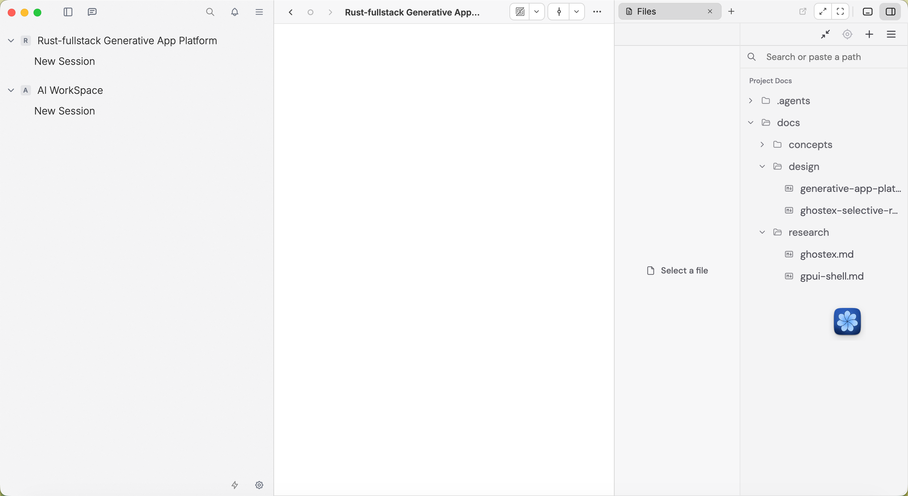

# 初版桌面界面规格与 Ghostex 代码裁剪方案

修订日期：2026-10-17（北京时间）。状态：D0 可运行候选已实现、编译并打包；自动化与原生窗口验证结果、尚未通过的人工验收项见 [D0 验收记录](../verification/d0/README.md)。D1 动态 App 尚未实现。

## 1. 已确定的交付范围

用户要求：**初版完整保留 Ghostex 的界面；右侧工作区只保留文件预览和终端；只需要桌面端代码；设置只保留最小必要项。** 后续用户已批准按本规格实现 D0；工程位于 `apps/desktop`，本地 `.app` 与启动步骤见 [运行说明](../../README.md)。

设计方向：在 GPUI Kit 中延续 Ghostex 的原生桌面外观、信息密度、布局与操作习惯，让用户在熟悉的项目、会话、文件和终端之间工作。主操作是选择项目、进入会话并向 Pi 提交任务，随后查看文件或使用终端。

| 范围 | 初版决定 |
|---|---|
| 技术与系统 | 原生 Rust / GPUI Kit 桌面应用，先支持 macOS |
| 主界面 | 保留 Ghostex 的窗口框架、项目会话侧栏、中央聊天区、顶部工具栏和右侧标签工作区 |
| 右侧视图 | 仅 `Files` 与 `Terminal`，包括菜单、快捷键、恢复记录中的可用视图 |
| 设置 | 同一原生视觉体系下的紧凑表单，4 个可编辑配置项，详见第 5 节 |
| 本地运行逻辑 | 保留项目、会话、消息、草稿、文件读取、PTY、Pi 接入与本地存储所需的 Rust 模块 |
| 动态 App | 延续 gpui-shell 条件采用路线；在桌面基线之后验证，不作为初版右侧第三类工具 |
| D0 产物 | Cargo workspace、桌面代码、Cargo.lock、本地 Zig/VT 构建、未签名 `.app`、来源记录、自动化与原生截图 |

“完整保留界面”约束保留功能的视觉和交互，不要求继承 Ghostex 的移动端、远程服务、浏览器、IDE 和全部设置。已裁掉的功能同时移除入口；不把原图标改作无关用途，也不留下无效按钮。

本文件是当前桌面初版的具体规格；[平台概念](../concepts/generative-app-platform.md) 描述长期目标，[架构方案](./generative-app-platform-architecture.md) 规定桌面与后续 App 承载边界，[选择性复用方案](./ghostex-selective-reuse.md) 记录整体取用原则。

## 2. 截图与视觉基线



参考图来自用户本轮附件，原样保存为 [ghostex-desktop-reference.png](assets/ghostex-desktop-reference.png)，没有重绘。文件为 **2816 × 1538 像素**；显示缩放和设备像素比未知，不能把图片像素直接当作 GPUI 的逻辑尺寸。SHA-256：`edf323dddfcf9860e004e184527ad3c174bb92d8b5358721d51882341b1680d9`。

### 画面中已确认的结构

- 左侧是项目与会话侧栏，上方为紧凑工具栏，下方保留设置入口。
- 中央是会话工作区，顶部有导航、会话标题及操作区；参考图的正文当前为空。
- 右侧有 `Files` 标签、关闭与新增入口、工作区控制按钮。
- `Files` 内部是**左侧文件预览、右侧文件树**；文件树上方有路径/搜索输入。未选文件时预览显示 `Select a file`。
- 窗口整体使用浅色中性背景、细分隔线、紧凑行高与图标，保留原有字体层级、截断方式、选中和悬停反馈。

按参考图估算，三大区域宽度约为侧栏 30%、中央 37.5%、右侧 32.5%；右侧内部预览与文件树约为 43:57。这是参考图的分隔条状态，用于首次还原对比，不是所有窗口的固定百分比。实现时先从锁定源码提取尺寸与主题变量，再结合实际窗口逻辑尺寸校准；用户拖拽后保存自己的宽度。

参考图没有展示活动聊天、终端、设置或深色主题。这些状态从同一版本的 Ghostex 原生实现延续其视觉语言，之后用真实运行截图验收，不能据本图声称已经逐像素验证。文件树上的蓝色浮动图标来源未确认，不据此增加产品功能。

### 布局与主题约束

1. 三栏边界、标题栏层级、文件树方向、标签形态和工具栏密度保持 Ghostex 原貌；不另做首页、卡片仪表盘或 App 商店布局。
2. 提取应用持有的语义主题与尺寸变量，统一标题栏、标签栏、侧栏行、分隔线与空状态；不在每个视图中分别堆叠截图像素常量。通过 GPUI Kit 主题与 `rem` 尺寸实现一致缩放。
3. 首张视觉验收使用参考浅色主题；系统/深色模式保持相同布局与语义层级。品牌名称及数据换成本项目内容，功能标签先延续 Ghostex 的英文用词。
4. 桌面窗口支持拖拽分隔条、隐藏侧栏、收起右侧和右侧最大化。侧栏开关由窗口持有并固定在 macOS 窗口按钮右侧，工作区开关固定在窗口右上角；展开、收起、自动隐藏均不改变其位置、元素身份或操作入口。较窄窗口优先收起辅助面板，恢复时保留位置；达到各区域的内容最小宽度后停止压缩，不挤压输入框或产生窗口级横向滚动。
5. 具体最小窗口尺寸在原生原型中测量后确定，覆盖 100%、125%、150% UI 缩放。主内容、文件树、预览和终端各自滚动，滚动和焦点不串到其他区域。

## 3. 主窗口与会话

| 区域 | 保留的界面与行为 | 裁剪边界 |
|---|---|---|
| 原生窗口与标题区 | macOS 窗口按钮、工具栏位置、分隔线、项目/会话标题及截断、导航、面板开关 | 不新增跨设备/浏览器状态入口 |
| 左侧栏 | 项目分组、展开收起、项目目录、会话列表、`New Session`、选择与重命名、归档/恢复/删除、会话状态、底部设置 | 去掉远程机器、AgentBox、团队、多账号、自动化等专属分组与菜单 |
| 中央聊天区 | Ghostex 的消息排列、流式回复、工具调用/结果、折叠内容、附件、输入区和发送/停止状态 | 首期接 Pi；不保留其他 Agent 的选择项或不支持的输入方式 |
| 会话标题与输入工具 | 保留已有操作位置；提供 Pi 实际支持的模型、推理配置和会话操作 | 没有真实引擎能力的项目不出现在菜单中 |
| 搜索、提醒与命令菜单 | 保留本地项目/会话搜索、待用户处理的会话提醒、已实现命令 | 清理云通知、远程控制、扩展、浏览器和未实现功能的命令 |

聊天中的工具结果、文件引用和行内 Diff 延续 Ghostex 的表达方式；点击文件引用可以打开 `Files`。行内 Diff 不产生独立 Diff/Review 工具标签。代码修改由 Agent 或用户终端完成，文件预览不扩展成完整编辑器。

会话状态至少区分未选择、加载、可输入、执行中、等待用户、已停止和错误。新会话与无项目状态使用原有空态语言，提供真实的打开项目或新建会话入口；参考图的空白不能被推断为发送成功或加载完成。

项目、会话、消息和草稿由本地 Rust 模块持有。切换会话保留草稿与滚动位置；重启后恢复项目列表、历史、草稿、布局及 Pi session reference。运行中的任务需要核对引擎状态，不能因 UI 恢复而自动重发上次请求。Pi 未安装或启动失败时，在当前会话提供可操作的错误与设置入口，保留用户输入。

会话行与标题栏使用常驻 `…` 菜单，提供 `Archive Session`、`Restore Session`、`Delete Session…`。归档保留历史和草稿，在项目的 `Archived` 分组中查看；归档视图只读、不自动启动 Pi，已经运行的 Pi 继续执行。恢复后回到普通会话列表。归档或删除当前会话后，优先选中该项目的其他普通会话；没有时清空当前选择，不主动新建会话。删除确认框必须命名会话，说明会永久删除消息、草稿和应用管理的 Pi 历史、终止对应 Pi 进程及工具，并保留项目文件。等待启动中的 Pi 返回、终止并回收后才能清理历史；删除中的事件和写入不得重新生成该会话。SQLite 失败保留会话和历史；历史文件清理失败单独报告。退出应用等待已提交的会话变更和进程清理完成。

项目与会话保持不同层级：项目行使用文件夹图标、加粗名称及灰色目录路径；会话行继续缩进，使用较轻字重和聊天图标。项目行常驻 `… → Delete Project…`，确认框说明包含所有普通/归档会话、本地 Pi 历史及对应任务和终端，保留磁盘目录及项目文件。项目/会话/文件定位记录以一个 SQLite 事务删除，失败全部保留；删除成功后释放文件监听与终端状态，选择其他项目或回到打开项目空态。

聊天输入框提供 `/` 与 `@` 建议弹层，使用 Kit List 和原生弹层行为，输入焦点保留在 Textarea。`/` 包含桌面保留命令 `/new`、`/rename`、`/model`、`/settings`、`/stop`、`/help`，以及当前 Pi 连接的 `get_commands` 结果；未知命令不回退为普通模型提示。`@` 搜索当前项目内普通文件，选择后插入带必要引号的相对路径并加入现有附件。↑↓ 选择、Home/End 首尾、Enter/Tab 插入、Esc 关闭，插入与发送分开。后台文件搜索有遍历/结果上限，跳过构建目录和符号链接，按项目、会话、输入及光标版本丢弃过期结果；输入法组合期间隐藏建议，不截取候选键。完整 Pi TUI 指令集、跨项目引用和 Agent 提及暂不包含。

键盘命令接入原生菜单和 GPUI Action；输入控件、文件树与终端有独立焦点。弹窗关闭后返回原触发位置，终端焦点下的输入不被全局聊天快捷键误截获。图标按钮保留工具提示与可访问名称。

## 4. 右侧工作区

### 标签与面板行为

- 视图类型白名单只有 `Files` 和 `Terminal`；`+` 只列出这两项。保留 Ghostex 的标签选中、关闭、已有视图定位、面板收起/恢复及最大化操作。
- `Files` 使用项目范围的文件视图；可以有多个终端实例。项目切换时显示对应项目的文件选择和终端，不把当前终端工作目录静默改成新项目。
- 收起面板或切换标签只隐藏视图；终端进程和 Pi 执行状态由各自运行模块持有。关闭具体终端标签按下文终止规则处理。
- 旧布局中的 Browser、Code、Kanban、Automate、自定义扩展视图等在恢复时丢弃，保留其余有效标签；没有有效标签时回到 `Files`。菜单、快捷键与命令入口使用同一白名单。
- 面板最大化后仍有清晰的恢复按钮；关闭最大化面板后恢复中央会话。收起/恢复不丢失文件选择、预览滚动或终端输出。

### Files：只读文件预览

| 能力 | 初版规格 |
|---|---|
| 布局 | 左预览、右文件树；保留两者间可拖拽分隔条、路径/搜索栏、原有工具栏样式 |
| 范围与定位 | 以用户打开的本地项目为根；支持树展开、文件名/路径定位、复制路径、在 Finder 中显示、系统外部打开 |
| 格式 | 原生只读文本/代码、Markdown 和常用图片；代码保留语法展示所需能力 |
| 外部格式 | PDF 和暂不支持的二进制格式显示文件信息与系统打开入口；HTML/JS 按源码预览，内嵌脚本不执行 |
| 状态 | 未选文件、读取中、读取失败、文件已删除、超大文件/不支持格式均在预览区反馈，文件树与当前定位保持可用 |
| 更新 | 文件监听触发异步重读并保留可用的选中与滚动位置；项目切换或文件变更后的过期结果不覆盖当前预览 |

上述格式是本项目初版范围，不能由 Ghostex 的完整 `native_docs` 能力反向扩大。裁掉文档编辑、批注、写回、嵌入浏览器、代码服务器及完整 IDE。大文件采用限量读取或明确提示，不在 UI 线程同步加载；路径与链接先解析到实际目标，超出已打开项目范围时不静默读取，使用明确的用户打开操作处理。

### Terminal：真实本地终端

终端沿用 Ghostex 的原生呈现、颜色层级、滚动、选择与输入习惯，连接本地 PTY 和 VT 解析/渲染，支持 shell 交互、复制粘贴、中文输入、窗口 resize、新建与切换终端。初始工作目录来自终端所属项目，界面持续标明所属项目和退出状态。

已提取 Ghostex 的 `ghostty_vt` 包装，按 `terminal_model`、`terminal_element` 的 PTY/VT/GPUI 路径适配精简模型与原生视图；保留 `portable-pty` 与 libghostty-vt 构建链。Kit 最小窗口、VT 静态库、真实 PTY 输入输出/resize/退出已验证；原生中文输入法候选交互等尚未通过的项目单列于验收记录，不以 UTF-8 粘贴替代其验收。

面板隐藏时终端继续运行。关闭有活动进程的终端标签时说明将终止该终端，并提供取消；用户确认后由终端模块结束并回收进程。退出桌面应用同样处理活动进程，不承诺关闭应用后后台常驻或重启后恢复原 PTY。重启可恢复终端布局和目录，并明确创建新终端；要支持进程跨宿主退出存活，必须另立恢复方案，初版不引入 zmx/wmx daemon。

用户主动使用的本地终端与后续生成 App 的权限分开。保留桌面 Terminal 不意味着脚本 App 获得 `process.spawn`、任意路径或终端输入能力。

## 5. 最小设置

保留侧栏齿轮与 macOS `Cmd+,` 入口。沿用 Ghostex 原生弹窗、表单行与控件风格，缩减成一个紧凑设置窗口；不保留原来的多页设置目录和无内容分类。

| 分组 | 可编辑项 | 默认与反馈 |
|---|---|---|
| Appearance | 主题：System / Light / Dark；UI 缩放 | 默认跟随系统、100%；立即生效，并统一影响界面尺寸 |
| Agent | Pi 可执行文件路径 | 默认自动发现；显示发现路径与可用状态，允许手动选择，不在 render 中探测 |
| Terminal | Shell 可执行文件路径 | 默认用户登录 shell；允许手动选择，显示校验错误 |
| About | 无可编辑项 | 本应用版本、运行依赖版本状态、数据目录与打开目录入口 |

合计 **4 个可编辑项**。终端默认采用系统等宽字体并跟随 UI 缩放，不增加字体目录、透明度、主题编辑器或高级终端配置。Pi 模型与推理选项留在会话原有位置；凭据与 provider 使用 Pi 自身配置，初版不复制账户管理系统。缺失配置在会话中提示真实原因并指向 Pi 配置方式，不展示伪造的连接成功状态。

路径编辑失败保留输入和具体错误，不覆盖上一份有效配置。设置经本地模块校验并持久化，失败可重试；Pi/Shell 路径只影响新启动进程，不暗中重启正在执行的会话。关闭后重新打开必须读回已保存值；对话框关闭与焦点恢复遵循原生行为。

删除 Remote、Cloud Boxes、Accounts、Integrations、Extensions、Actions/Automation、AgentBox、多 Agent 管理、移动端配对、浏览器、IDE、调试目录和自定义快捷键配置页；保留内置快捷键及原生菜单提示。删除项不以灰色“即将推出”占位。

## 6. 上游代码取用与裁剪表

源码锁定为 [Ghostex @ 05c27ecc77d738ad853f2db0d574bffa02a23a77](https://github.com/maddada/Ghostex/tree/05c27ecc77d738ad853f2db0d574bffa02a23a77)。下表是已核对存在的入口，**不是能够单独复制即编译的文件清单**；实际提取需追踪每个入口的最小依赖集合。

| 上游入口（相对仓库根） | 取用方式 | 必须解除的耦合 |
|---|---|---|
| `apps/desktop/src/app/native_sidebar/` | 优先提取项目/会话行、布局、状态呈现与交互 | 排除机器、AgentBox、自动化、账户用量等分组；改接本地项目/会话模型 |
| `apps/desktop/src/app/native_chat/` | 优先提取消息、composer、工具结果与会话状态的原生呈现 | 改接本项目消息和 Pi 事件；不整包引入 gx-chat-core 或 gxserver 客户端 |
| `apps/desktop/src/app/render/workarea_header/` | 保留标题、导航和操作区的呈现 | 过滤远程、浏览器、IDE 等菜单命令 |
| `apps/desktop/src/app/render/view_tab_strip.rs`、`view_picker.rs` | 保留标签栏及 picker 的视觉和操作 | 视图注册只保留 Files/Terminal，改接本地状态 |
| `apps/desktop/src/app/view_panel.rs`、`render/workarea_split.rs`、`view_scopes.rs` | 参考/提取面板开关、分隔条、焦点和恢复行为 | 不继承完整 `TitlebarMode`、扩展 scope 或服务端同步模型 |
| `apps/desktop/src/app/consts/workarea.rs` | 提取相关几何关系与共享尺寸，映射到本应用变量 | 与原 GPUI 依赖、旧主题和其他 view 的常量分离 |
| `apps/desktop/src/app/native_docs/` | 选择文件树、打开、监听、只读预览、外部打开的实现 | 排除编辑/批注/写回、Browser area 和远程文件路径 |
| `apps/desktop/src/terminal_model.rs`、`terminal_model/` | 提取 PTY 生命周期、快照、唤醒及 I/O 行为 | 使用本地 shell 启动；排除 zmx/wmx attach、远程控制和聊天探测链 |
| `apps/desktop/src/terminal_element.rs`、`ghostty_vt/` | 优先验证原生终端渲染和 VT 包装移植 | 统一 GPUI 版本；核对 FFI、字体、输入法、剪贴板和 libghostty-vt 构建依赖 |
| `apps/desktop/src/app/window/native_modal_kit/`、`settings_modal/` | 提取必要表单样式/行为，重建最小设置页面 | 不引入完整 settings catalog、迁移链和原设置 store |
| `apps/desktop/src/app/gx_store/`、`packages/gx-core/`、`packages/client-storage-native/` | 参考状态所有权、草稿与持久化规则，自建需要的模型 | 不复制 Ghostex 的全量 store、RPC、Chromium 数据迁移与产品状态 |
| `server/src/session_chat_decode_pi.rs`、Pi 官方 RPC 文档 | 参考消息规则，通过官方 Pi RPC 接入 | 不把 gxserver/transcript/终端探测当成必要运行依赖 |

可复查的固定来源：[桌面依赖](https://github.com/maddada/Ghostex/blob/05c27ecc77d738ad853f2db0d574bffa02a23a77/apps/desktop/Cargo.toml)、[原生侧栏](https://github.com/maddada/Ghostex/tree/05c27ecc77d738ad853f2db0d574bffa02a23a77/apps/desktop/src/app/native_sidebar)、[原生聊天](https://github.com/maddada/Ghostex/tree/05c27ecc77d738ad853f2db0d574bffa02a23a77/apps/desktop/src/app/native_chat)、[Files](https://github.com/maddada/Ghostex/tree/05c27ecc77d738ad853f2db0d574bffa02a23a77/apps/desktop/src/app/native_docs)、[PTY Model](https://github.com/maddada/Ghostex/blob/05c27ecc77d738ad853f2db0d574bffa02a23a77/apps/desktop/src/terminal_model.rs)、[VT 包装](https://github.com/maddada/Ghostex/tree/05c27ecc77d738ad853f2db0d574bffa02a23a77/apps/desktop/src/ghostty_vt)、[原设置目录](https://github.com/maddada/Ghostex/blob/05c27ecc77d738ad853f2db0d574bffa02a23a77/apps/desktop/src/app/window/settings_modal/tabs/mod.rs)。

### 构建与依赖范围

Ghostex 的 `apps/desktop` 仍依赖共享 crate、gxserver 客户端、CEF、终端原生库和仓库构建约定。因此按能力迁移到自己的桌面工程，逐项建立依赖，不以复制原 Cargo manifest 作为起点。

保留 GPUI Kit、所需资产、SQLite、异步 I/O、Pi 适配及 PTY/VT 必要依赖；先做单一 macOS 桌面交付。移除 CEF/WebView、React/Web 构建、移动端/WASM、Browser、code-server/VS Code、远程连接、云盒子、配对、团队、扩展商店、多账户轮换及其专属资产、helper binary、脚本和打包步骤。未来其他桌面系统另验，不携带只服务于已裁功能的平台后端。

GPUI 依赖统一从 `gpui-kit` 集成入口使用 `gpui_kit::*`、`component`、`base`、`assets`；不得同时保留 Ghostex 的旧 Zed git GPUI 和 Kit 的另一套 GPUI 类型。迁移自定义元素与终端时验证同一依赖谱系。第三方 VT 依赖按其自身版本和许可锁定。

“只要桌面端代码”仍包含桌面本地运行模块，以及 Pi/PTY 所需子进程；不单独分发 gxserver、HTTP/WebSocket 控制平面或远程 daemon。删除上游 server 不等于删除会话、存储、取消和进程回收职责。

## 7. 本项目代码组织与迁移顺序

以下能力目录已创建，均在 `generative-app-desktop` crate 内；不按上游大模块机械搬运，有独立构建/复用需求后再拆 crate。实际来源和修改见 [THIRD_PARTY.md](../../THIRD_PARTY.md)。

```text
apps/desktop/
  src/
    main.rs                 # 启动与原生应用入口
    shell/                  # 窗口、主题、菜单、面板组合与布局持久化
    workspace/              # 项目、会话、消息、composer 与 Pi 接入
    files/                  # 树、只读预览、文件监听与外部打开
    terminal/               # 终端视图、PTY、VT 与进程生命周期
    settings/               # 4 项配置、校验、持久化与 About
    storage/                # 共享数据库连接、迁移执行基础设施
  scripts/build-vt.sh        # 项目本地 Zig 与静态 VT 构建
  build.rs                  # 仅实际需要的原生依赖构建
```

每个能力把模型、视图、命令和适配放在同一功能目录中；shell 负责组合。workspace 拥有会话，files 拥有读取和预览状态，terminal 拥有 PTY，settings 拥有配置。共享 storage 不变成可任意修改各功能状态的全局 store。

单窗口只由宿主初始化一次 GPUI Kit `Root` 与 overlay/focus 环境，不为每个面板嵌套 Root。输入、文件树和终端保留各自 `Entity`、稳定身份及订阅；不在 `render` 内创建进程、读文件、建状态或探测配置。后台工作完成后按项目/会话/实例身份核对结果，再更新仍有效的 View。

实施顺序：

1. **建立来源清单。** 记录上游 SHA、原路径、实际复制文件、许可和本地修改；复制实质代码时保留 [Ghostex MIT 许可](https://github.com/maddada/Ghostex/blob/05c27ecc77d738ad853f2db0d574bffa02a23a77/LICENSE) 与对应第三方 notice。
2. **建立桌面外壳。** 锁定 GPUI Kit，迁移主题/布局变量、窗口、侧栏、聊天框架和两类标签，先复现参考图结构。
3. **接本地运行能力。** 持久化项目/会话/草稿；连接 Pi；完成 Files；独立验证并接入 PTY/VT。移植遇到上游 store/RPC 调用时替换成该能力自己的接口。
4. **完成裁剪。** 同步移除功能注册、菜单、快捷键、设置、旧布局恢复分支、依赖、构建与资产。检查应用产物没有运行时拉起 Ghostex 或 CEF 的路径。
5. **完成 D0 验收。** 用真实数据和原生截图验证下表，修复布局、焦点、错误与重启恢复。不能用空壳或模拟终端替代。
6. **进入 D1。** 再验证 gpui-shell、受控 HostModule、App 安装/更新等平台能力，按 [G1–G6](./generative-app-platform-architecture.md#9-构建配置与采用前的验证关口) 验收。其后续导航与挂载位置另行确定，不在 D0 中增加入口。

## 8. 后续实现验收要求

| 验收面 | 必须取得的结果与证据 |
|---|---|
| 参考图还原 | 记录逻辑窗口尺寸、截图像素与设备比例；在相同条件下对比三栏、Files 内部分隔、标题/标签/行高、字体、图标和边线 |
| 会话主流程 | 打开项目 → New Session → 真实 Pi 回复 → 工具结果/停止/错误；切换会话草稿仍在；归档/恢复可持久化，归档历史可查看；删除取消与确认、存储失败保留记录、Pi 启动竞态回收均有证据；输入法与焦点正确 |
| Files | 从树和聊天文件引用打开文本/Markdown/图片；重读、删除、不可读、超大文件与外部打开均有明确结果 |
| Terminal | 真实 shell 输入输出、中文输入、复制粘贴、resize、项目归属、隐藏后继续输出、退出状态及取消/确认终止 |
| 视图裁剪 | 所有 picker、菜单、快捷键、命令与恢复数据仅能打开 Files/Terminal，旧类型有确定回退 |
| 设置与恢复 | 4 项配置保存后读回；错误输入不覆盖有效值；重启后项目/历史/草稿/布局恢复，终端明确新建，无任务重复发送 |
| 桌面适配 | 窗口缩放、辅助面板收起/恢复/最大化、100%/125%/150% UI 缩放与浅/深色；无重叠、裁切和跨区滚动 |
| 依赖与交付 | macOS 包独立启动，Pi 缺失有引导；所需 VT 资源可用；无移动/Web 产物、gxserver 或 CEF 启动依赖 |

本次只完成规格、固定源码路径核对和参考图归档。尚无可运行产品、移植后的依赖验证、界面截图对比或以上验收结果；原图本身不是实现证据。
