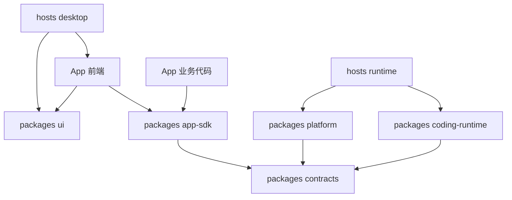

# Generative App Platform monorepo 架构方案

> 状态：架构方案 v0.1  
> 日期：2026-10-12（北京时间）  
> 定义修订日期：2026-10-14（北京时间）  
> 基础：[产品与架构讨论稿](../concepts/generative-app-platform.md)、[Agent UI Runtime 接入契约](./agent-ui-runtime-contract.md)、[Pi Durable 1.1 调研](../research/pi-durable-1.1-research.md)

平台采用一个 monorepo 管理桌面宿主、共享运行模块和内置 App。顶层以 `hosts/`、`packages/`、`apps/` 区分运行入口、平台模块与应用工程；内置 App 和生成 App 使用同一套工程布局与 SDK。用户生成的工程、安装后的版本产物和实际业务数据由平台在仓库之外管理。

这套组织方式支持先交付 Coding 工作区，再创建自媒体 App，并通过同一平台持续塑造应用。Pi Durable 1.1.0 是 Coding Runtime 的优先验证候选，具体托管、隔离与打包机制通过首期实现验收后确定。

## 1 设计基线

- 平台面向个人本地使用，桌面宿主采用 Tauri 2，首期支持 macOS。项目、工具执行和持久数据在本机，模型可以调用云端服务。
- App 是具有稳定身份和长期工作上下文的应用；Surface 是 App 内的任务界面。AppVersion 表达不可变版本，AppChange 表达创建或塑造的交付过程。`apps/` 中每个工程对应一个 App，多个 Surface 在该工程内部组织。
- 托管 App 以“源码工程 + 接入声明”交付，界面、业务逻辑、工作约定、数据结构与迁移定义共同形成应用版本。
- Coding 元能力统一承接软件开发与业务 Agent 任务。Coding 工作区提供调用与干预界面，App Builder 和其他 App 复用同一运行实现。
- 应用源码、版本产物、业务数据与执行记录分别管理。版本切换按兼容与迁移约定延续数据和任务。

术语沿用 [GLOSSARY](../../GLOSSARY.md)。首期 React 与 TypeScript 的接入范围沿用 [Agent UI Runtime 契约](./agent-ui-runtime-contract.md)；下文的文件布局以此为工程起点。

## 2 仓库目录

```text
generative-app-platform/
├── hosts/
│   ├── desktop/
│   │   ├── src/                         # 平台 Shell、App 导航、原生交互接入
│   │   └── src-tauri/                   # Rust 宿主、进程管理、原生能力
│   └── runtime/
│       └── src/                         # 本地进程入口、通信、模块装配
│
├── apps/
│   ├── coding/                          # 首个内置 App
│   │   ├── app.manifest.ts
│   │   ├── src/
│   │   │   ├── frontend/
│   │   │   └── backend/
│   │   ├── instructions/
│   │   └── tests/
│   └── media/                           # 后续自媒体 App 与受控样例
│
├── packages/
│   ├── contracts/                       # 跨模块、跨进程的声明与消息结构
│   ├── app-sdk/                         # App 开发与接入接口
│   │   └── src/
│   │       ├── client/
│   │       ├── backend/
│   │       └── react/                   # Agent UI Runtime 的 React 接入
│   ├── platform/
│   │   └── src/
│   │       ├── registry/
│   │       ├── app-runtime/
│   │       ├── app-builder/
│   │       ├── app-changes/
│   │       ├── permissions/
│   │       └── storage/
│   ├── coding-runtime/
│   │   └── src/
│   │       ├── tasks/
│   │       ├── sessions/
│   │       ├── tools/
│   │       ├── decisions/
│   │       └── engines/
│   │           └── pi-durable/
│   └── ui/                              # 共享视觉组件
│
├── templates/                           # 生成 App 的工程起点
├── tests/                               # 跨模块与宿主的完整场景
├── tooling/                             # 开发、构建与打包脚本
├── docs/
└── GLOSSARY.md
```

目录描述模块归属，按交付需要逐步建立。`media/`、`templates/` 和尚未实现的内部模块随实际功能增加；首期保留上述职责划分，不预先创建空包。

`hosts/` 对应需要启动或打包的宿主。`packages/` 中的包按各自接口提供能力，内部可以包含多个模块。`apps/` 保存随仓库开发与交付的内置 App 和受控样例；用户安装多少个 App，不影响平台 monorepo 的目录数量。

## 3 宿主职责

### desktop

`hosts/desktop/src` 提供平台 Shell、App 发现与切换、塑造入口和原生交互接入。Coding 工作区的文件、会话、Diff 和 Preview 界面位于 `apps/coding`，由桌面宿主承载。

`src-tauri` 管理窗口、WebView、本地运行进程及原生能力，并为来自不同宿主上下文的调用绑定实际身份与范围。凭据和原生资源通过宿主或本地运行模块提供受控访问。

### runtime

`hosts/runtime/src` 是本地运行进程的装配入口，负责启动、通信、健康状态与关闭顺序。它装配 Platform、Coding Runtime、存储和能力实现；任务推进、应用交付等行为各自保留在对应模块中。

首期由桌面宿主管理一个本地运行进程。每份 Harness 存储只由一个活动 owner 管理，客户端通过平台接口观察和控制任务。是否按 App 分配 Harness 与存储，以及生成业务代码是否需要独立进程，按托管与隔离验收确定。

宿主通信先验证标准输入输出方案。消息需要表达请求身份、任务关联、错误、输入请求、取消和结果；平台任务接口保持独立于传输协议。

## 4 共享包职责

| 包 | 对外提供的接口 | 内部负责的实现 |
|---|---|---|
| `contracts` | App 接入声明、任务请求与结果、业务动作及跨进程消息的结构 | 可序列化数据的结构校验与版本兼容约定 |
| `app-sdk` | App 声明、业务动作接入、上下文捕获、任务调用、观察与提案审阅 | 宿主连接、调用绑定、React 接入与 Agent UI Runtime |
| `platform` | App 注册与管理、托管、构建、预览和版本生效 | App Registry、App Runtime、App Builder、AppChange、授权与平台存储 |
| `coding-runtime` | 提交、观察、指导、取消任务，查询结果与必要的诊断信息 | 会话与任务推进、模型接入、工具执行、恢复和决策模型接入 |
| `ui` | 共享视觉组件 | 样式、基础交互与通用展示 |

### contracts

仅将真正跨模块或跨进程的契约放入 `contracts`。App 的业务类型与各模块的内部类型留在所属工程；Pi 的 Harness、Conversation、内部 Task 和存储对象由引擎适配实现管理。

平台 Task 表达用户目标、范围、进度、实际结果与完成证据。它可以关联多个 Durable 内部 Task；引擎进入 terminal 状态后，平台仍按业务保存、软件验证或版本生效等完成条件判断结果。

### app-sdk

App 使用 `app-sdk` 接入平台，而不是依赖平台内部模块。`client` 提供绑定于 App 的调用客户端；`backend` 提供业务动作与运行接入；`react` 实现 Surface 注册、请求时上下文捕获、任务订阅和提案审阅等 Agent UI Runtime 行为。

SDK 按浏览器与业务执行环境提供独立入口。前端入口不引入 Node、原生调用实现或凭据加载代码。

业务动作通过长期运行的业务实现执行，能够在编辑器或 Surface 关闭后被调用。React 回调负责界面交互和语义接入，业务事实、修订检查、授权与原子提交由 App 的业务模块及实际执行实现持有。

首期 Agent UI Runtime 与 React 接入共同放在 `app-sdk` 中。出现独立交付或其他 UI 技术的实际需求后，再评估是否拆包。`ui` 则聚焦视觉复用；业务事实与 Agent 语义由 SDK 和 App 显式接入。

### platform

`registry` 管理稳定 App 身份与 AppOrigin、App 管理状态、可用版本及当前有效版本。App 的 `managementState` 与 AppChange 的草稿、预览和交付进度分别记录；`currentVersionId` 指向属于该 App 且已完成交付校验的 AppVersion，首次版本生效前可以缺省。`app-runtime` 负责加载版本、绑定业务数据与已授权能力、管理运行资源。

`app-builder` 将需求、基线工程和接入要求组织为软件任务，调用 Coding 元能力并确认候选产物。`app-changes` 关联需求、基线、候选、验证、迁移与生效结果。两者先作为 Platform 内部模块；各个 App 中的塑造入口调用同一份实现。

`permissions` 管理调用身份与能力授予，实际业务服务和执行环境执行检查。`storage` 管理平台元数据与存储接入；具体业务规则、数据结构和迁移定义属于对应 App。

### coding-runtime

引擎接入放在 `src/engines/pi-durable`，集中处理 Harness、Conversation、Submission、Registry、Storage 和 ExecutionEnv 与平台契约的映射。平台自己的任务管理保留目标与结果语义，执行检查点和底层调度优先复用 Durable。

模型、工具、skills、项目上下文和决策能力按任务装配。开发任务使用获授权的文件与命令能力，业务任务使用相应 App 的业务动作。Coding 工作区、App Builder 和业务 App 共享运行实现，各自保留工具与数据范围。

引擎适配以实际使用的任务接口组织。Coding Agent SDK 作为对照接入候选，只有进入对照实现时再增加对应 adapter。

## 5 依赖与运行调用

以下箭头表示源码依赖；运行时通信由宿主装配。



Platform 与 Coding Runtime 通过平台契约协作，由 Runtime 宿主注入实际调用和能力实现。App Runtime 按接入声明加载 App；图中不将动态加载画成静态源码依赖。

工程依赖遵循以下规则：

1. App 通过 SDK 接入平台，跨 App 的能力复用经过明确的能力契约与授权。
2. `contracts` 保持独立于 React、Tauri、Pi 和具体存储实现；各共享包通过公开入口提供接口。
3. Platform 与 Coding Runtime 避免循环源码依赖，平台业务动作以注入的接口供执行模块调用。
4. Pi 内部类型留在引擎适配实现中；App SDK 与平台契约使用平台对象和结果语义。
5. 宿主负责装配，App 定义自己的业务，共享包各自持有职责内的实现与验证。

以“精简这一段”为例，Surface 先捕获文章、选区与修订，SDK 提交绑定的任务。宿主确认调用身份，Coding Runtime 推进任务并调用相应业务动作。App 业务模块保存提案、检查当前修订并处理审阅，返回持久 Operation 与实际结果；界面订阅这些状态并恢复展示。

目录和 import 规则表达代码归属。生成代码的访问范围还需要由实际托管上下文、能力执行与授权实现约束；具体隔离机制是首期托管验收的一部分。

## 6 App 工程布局

内置 App 和生成 App 使用同一接入声明与 SDK，并以相同流程验证业务行为、生成产物和加载版本。Coding App 可以获得专门授予的开发能力；授予范围由平台绑定。

```text
app-project/
├── app.manifest.ts
├── src/
│   ├── frontend/                 # Surface、编辑器与展示
│   └── backend/                  # 业务对象、动作、规则与流程
├── assets/
├── instructions/                 # 工作约定与技能配置
├── migrations/                   # 业务数据结构与迁移定义
├── tests/
└── package.json                  # 依赖、构建与检查入口
```

工程内按业务组织模块。`app.manifest.ts` 是源码布局起点，交付时形成可校验的 AppManifest，关联实际程序入口、业务动作、能力与兼容要求；最终声明格式及构建产物形式随托管原型确定。

文章、引用记录、用户实际工作内容和任务记录保存在平台数据目录中。测试样本与 migration 定义可以随工程版本管理。模板用于创建工程，不限制 App 必须使用固定视觉组件；生成的 App 按相同 SDK 与运行契约接入。

## 7 工程与运行数据管理

用户的软件项目可以留在用户选择的目录。平台托管 App 工程使用平台管理的目录，或登记用户选择的工程位置；安装后的产物与持续运行数据位于独立的平台数据目录。

```text
平台数据目录/
├── projects/<project-id>/                     # App 工程与候选修改工作副本
├── artifacts/<app-id>/<version-id>/           # 已构建的版本产物与声明
├── app-data/<app-id>/                         # 按稳定 App 身份延续的业务数据
└── runtime-data/                             # 平台元数据、会话、任务与恢复记录
```

这是一份逻辑布局。具体文件、SQLite 表与索引形式由存储实现确定。项目可以登记外部路径，多个逻辑目录也不要求各自使用独立数据库。

平台元数据关联 App、AppVersion、工程基线、产物、AppChange 和当前有效版本。AppVersion 的源码快照、AppManifest 与产物不可变且保持可追溯；工作副本的修改属于 AppChange，不回写已登记版本。AppOrigin 保留 App 首次建立的来源，后续修改依据由 AppChange 记录。运行数据按稳定 App 身份延续。更新桌面安装包时，通过兼容与迁移约定继续使用平台数据目录。

一次塑造的交付顺序为：

1. 记录目标 App、当前版本、需求与完成条件，从基线创建候选工程。
2. App Builder 调用 Coding 元能力生成修改，保存候选源码、产物与验证证据。
3. App Runtime 在独立预览上下文中运行候选版本，使用受控副本或测试数据。
4. 生效前重查 App 基线与业务数据，完成必要的保存、兼容检查和迁移，再切换有效版本。
5. 记录实际生效结果，保留仍被任务引用的旧版本资源，并按引用与恢复规则释放。

构建期间已有 App 可以继续使用。预览写入绑定预览数据与能力范围；业务数据迁移和未完成任务的兼容处理分别验收。回退路径取决于数据与任务能否被旧版本继续处理。

## 8 Pi Durable 1.1 接入约定

优先验证固定 Pi Durable 1.1.0 与 lockfile，保留 Coding Agent SDK 对照。Durable 仍是实验性 harness，升级按平台使用场景重新验证。具体上游事实与来源见 [1.1 调研](../research/pi-durable-1.1-research.md)。

| 能力或行为 | 平台接入约定 |
|---|---|
| 工具与 hook 的共享 Models | 供可信决策与执行扩展使用；App 调用受约束的模型能力接口，显式处理分类结果、恢复与费用记录 |
| 历史 context | 用于任务诊断与模型历史视图；业务对象历史通过其修订契约取得 |
| 双向分页与任务计时 | 暴露必要的列表与诊断字段，保留游标顺序和时间字段可缺失的语义 |
| 增量 context 缓存 | 使用引擎的派生缓存，按实际会话与内存测量配置保留期 |
| 工具恢复 | 按工具重放声明恢复；业务写入通过 Operation 身份确认已执行效果 |
| Registry 热替换 | 纳入平台扩展与 AppVersion 的发布约定，保留待恢复任务所需的实现与兼容信息 |
| Harness close 与 abort | 页面关闭释放订阅；完整退出保存可续状态并关闭运行资源；用户取消独立提交取消意图 |
| Storage owner | 每份存储有唯一活动 owner；外部观察入口通过该 owner 的平台接口连接 |

新模型入口和存储 adapter 留在 Coding Runtime 内部。Cloudflare 适配器作为未来宿主的候选，不改变首期本地部署顺序。

## 9 建设顺序与待定机制

先建立 `hosts/desktop`、`hosts/runtime`、`apps/coding` 和实际接入所需的共享包。模块内验证与实现放在一起，跨宿主和跨 App 场景放在根目录 `tests/`。构建工具和任务编排工具随真实构建需求选择。

| 阶段 | 工程交付 | 验收目标 |
|---|---|---|
| Coding 工作区 | 桌面与 Runtime 宿主、Coding App、任务契约、Pi 接入和开发能力 | 打包后完成真实项目修改与验证；关闭重开后可读取实际结果并按约定恢复 |
| App 创建与业务协作 | App SDK、托管接入、App Builder、生成模板与自媒体 App | 同一元能力完成应用创建和文章任务；再次进入保留业务上下文 |
| 持续塑造 | AppChange、候选版本、预览、数据迁移和版本生效 | 连续两次修改保留已有数据；一次失败更新有明确的有效版本与数据状态 |

内部模块只有出现独立交付、独立依赖或明确复用需求时才拆包。App Builder、App Runtime、决策模型 adapter 与 Agent UI Runtime 首期按上述归属实现。

首期原型需要收敛以下机制：

- 托管 App 界面与业务代码的实际加载、执行及隔离方式，包含预览上下文和调用身份绑定。
- 源码到可安装版本的产物形式、依赖范围、AppManifest 校验与数据迁移顺序。
- 本地通信、存储拓扑、进程 owner、Node sidecar 打包和任务恢复方式。
- AppVersion 与运行任务使用的扩展代码、工作约定及授权范围如何固定和升级。

这些选择通过 Coding 工作区与第二个业务 App 的完整流程验证，再收敛为稳定 SDK 和交付契约。
