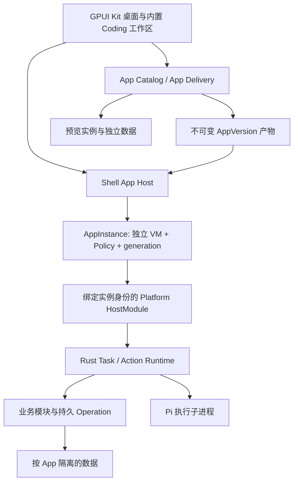

# Generative App Platform 架构方案

修订日期：2026-10-17（北京时间）。状态：D0 原生桌面可运行候选已实现、编译并打包，见 [运行说明](../../README.md) 与 [验收记录](../verification/d0/README.md)。本文的 gpui-shell、动态 App 安装/更新与业务 Action 仍是 D1 条件采用方案，尚未完成运行验证。

产品要求见 [平台概念](../concepts/generative-app-platform.md)；初版布局、最小设置与逐项代码裁剪以 [桌面界面规格](./desktop-mvp-ui-and-code-scope.md) 为准，整体取用原则见 [选择性复用方案](./ghostex-selective-reuse.md)。动态承载部分依据 [gpui-shell 调研](../research/gpui-shell.md)，源码基线为 [longbridge/gpui-kit @ eec1208dd57d8bc8abc769fd833d181d297790f9](https://github.com/longbridge/gpui-kit/tree/eec1208dd57d8bc8abc769fd833d181d297790f9)。线上文档可能落后于此版本，具体 Interface 以锁定源码为准。

## 1. 结论与首期范围

**先交付保留 Ghostex 界面的原生桌面 Coding 工作区（D0），再验证动态 App（D1）。** D0 保留项目会话侧栏、中央聊天区、顶部工具栏与右侧标签工作区；右侧只有 Files/Terminal，Files 内部左预览、右文件树。设置仅有主题、UI 缩放、Pi 路径、Shell 路径 4 个可编辑项。只建设桌面代码，先支持 macOS。

**推荐把 gpui-shell 作为首期动态 App 的原生界面承载目标，完成接入补齐和验证后采用。** 它解决“无需重新编译宿主，就能加载 JavaScript 描述的原生 GPUI 界面”。平台自建 App 的身份、产物、授权、业务数据、任务和交付机制。

首个内置 Coding 工作区由 Rust / GPUI Kit 实现；首个动态 App 是文章草稿工作台。生成 App 可以编写界面、交互、纯计算和业务流程组合，业务数据经平台动作持久化。首期复用 Rust 文档业务模块，不承诺安装任意动态 Rust 后端或把任意业务脚本变成可靠的后台任务。

| 对象 | 技术与职责 |
|---|---|
| 平台宿主、Coding 工作区（D0） | GPUI Kit 原生 Rust 界面；提取适配 Ghostex 的桌面呈现与交互 |
| Files / Terminal（D0） | 原生只读文件预览与文件树；本地 PTY/VT 终端，必要原生依赖随桌面打包 |
| 会话与本地运行（D0） | Rust 项目/会话/消息/草稿与布局存储、Pi RPC、终端进程管理 |
| 动态 App 的界面与交互 | JavaScript ES modules + gpui-shell；原生 GPUI 渲染 |
| 可复用控件 | 锁定并审计的 `gpui-component` 脚本绑定、平台自有组件与 `gpui-base` |
| 业务数据、提案与提交 | Rust 业务模块，持久 Operation，revision 与授权检查 |
| 生成和修改 App | Pi，经 Rust Task Runtime 接入，在候选工程工作 |
| 安装、更新、迁移与恢复 | 自有 App Delivery，绑定具体不可变产物 |

`gpui-shell` 当前为实验性、未发布 crate；其 `components` feature 已包含样式组件绑定，旧的 `gpui-component-shell` 已合并，不能按旧官网理解成只能使用无样式 Base。[crate 配置](https://github.com/longbridge/gpui-kit/blob/eec1208dd57d8bc8abc769fd833d181d297790f9/crates/shell/Cargo.toml)、[组件目录入口](https://github.com/longbridge/gpui-kit/blob/eec1208dd57d8bc8abc769fd833d181d297790f9/crates/shell/src/components/mod.rs)。

### 桌面代码与后续平台模块的边界

D0 运行链为 `GPUI Kit 窗口 → 本地 workspace / files / terminal / settings → SQLite、文件系统与 Pi/PTY 子进程`。按能力组织于 `apps/desktop`，每个能力共同持有模型、视图、命令和适配，shell 只组合窗口、菜单与面板。没有独立部署的 gxserver、Web 前端、移动端、远程控制平面或 CEF 依赖。

本地会话、取消、进程回收和存储仍属于桌面代码，不能随上游 server 一起删除。面板隐藏不结束任务或 PTY；关闭终端及退出应用按活动进程规则处理。初版不支持 PTY 在桌面退出后常驻，重启不能伪装成恢复了原进程。

D1 增量加入 Catalog、Delivery、Shell App Host 与业务 Action 等模块；有独立复用需求时再提取共享 Rust crate。G1–G6 是动态 App 采用关口，不阻塞 D0 的原生桌面交付。未来动态 App 的导航及挂载位置单独确定，不自动扩大 D0 的右侧视图白名单，也不预先添加 App 商店或未接入入口。

## 2. 从源码能力到平台能力

| 已有机制 | 能支持什么 | 平台仍需完成什么 |
|---|---|---|
| 目录中的入口模块、View 初始化与挂载 | 动态创建原生工作界面 | 产物校验、来源记录、App 与版本关联 |
| `PluginManifest`、Policy、HostModule | 描述需求、限定部分宿主能力、调用 Rust | 授权记录、细粒度业务范围和显式 Policy 加载入口 |
| Watcher 与应用 generation | 开发时重新读取模块、替换 View | 正式版本交付、数据迁移、崩溃恢复与兼容判断 |
| 按 id 的数据位置、`localStorage` | 跨启动的简单状态保存 | 业务数据事务、备份、并发写与 schema 迁移 |
| `check`、生成类型声明 | 发现部分加载、render 与原生元素构造错误 | 真实交互、布局、异步行为、权限和数据延续验收 |
| 已安装目录发现、`bundle` | 运行目录和导出独立桌面应用 | 平台内的安装记录、版本选择与受控更新 |

这是适用性判断，不把上游插件机制等同于平台 App 生命周期。[加载实现](https://github.com/longbridge/gpui-kit/blob/eec1208dd57d8bc8abc769fd833d181d297790f9/crates/shell/src/plugin.rs)、[CLI 与 check](https://github.com/longbridge/gpui-kit/blob/eec1208dd57d8bc8abc769fd833d181d297790f9/crates/shell/src/host.rs)、[安装目录发现](https://github.com/longbridge/gpui-kit/blob/eec1208dd57d8bc8abc769fd833d181d297790f9/crates/shell/src/host/installed.rs)。

## 3. 运行结构

以下是包含 D1 动态 App 的目标结构；D0 只实现桌面工作区及所需本地运行模块，不预建全部平台功能。



首期 Rust 核心与原生宿主可在一个进程中分模块实现。每个活动 AppInstance 使用独立 ShellRuntime、Policy 与模块注册表；预览和正式实例分别创建。独立 VM 降低共享模块缓存和故障影响，但它们仍在同一进程、同一 UI 线程，不能宣称具有进程级的内存、崩溃或执行隔离。

首期支持本机用户创建、经验证后安装的 App。平台生成代码不等于代码天然可信，校验也不能证明全部行为；实际可执行效果仍由受控 profile 和 Rust 动作检查约束。运行任意不可信第三方 App 不在这一承载方案的支持范围内；需要该范围时，先验证独立渲染进程与明确的 OS 隔离。当前没有现成的跨进程 GPUI 元素嵌入契约，不能把“放到子进程”当作已经解决工作区嵌入。

| Module | 对调用方提供的 Interface | 内部负责的规则 |
|---|---|---|
| App Catalog / Delivery | 建立变更、验证、预览、安装、更新、恢复 | App/版本关系、基线检查、交付日志、兼容性、备份与切换 |
| Shell App Host | 挂载指定版本、观察状态、停止实例 | VM、Policy、组件目录、generation、资源清理与失效回调 |
| Action Runtime | 发现能力、提交动作、查询 Operation | 可信调用身份、授权范围、幂等、revision、事务提交 |
| Task Runtime | 接纳任务、观察、取消、恢复 | 固定上下文、Session/Run、Pi 接入与结果证据 |
| Business Modules | 查询对象、保存提案、提交业务变更 | canonical 数据、业务不变量、schema 与迁移 |

这些是逻辑 Module，不要求首期各自成为 crate 或独立进程。

## 4. 必须补齐的加载 Interface

锁定源码中，`PluginManager::load` 接受的授权回调返回布尔值，内部从 Manifest 全量需求构建 Policy，不提供注入自有 HostModule 或缩减授予的 factory。`Policy::with_host_module` 虽然公开，完整的按 Policy 加载路径仍是内部实现；便利加载入口使用默认 Policy。[PluginManager 与加载路径](https://github.com/longbridge/gpui-kit/blob/eec1208dd57d8bc8abc769fd833d181d297790f9/crates/shell/src/plugin.rs)、[Policy](https://github.com/longbridge/gpui-kit/blob/eec1208dd57d8bc8abc769fd833d181d297790f9/crates/shell/src/policy.rs)。

平台维护小范围的上游接入补丁，或推动等价公共入口：**由宿主显式传入 Policy，覆盖入口模块求值、View 初始化、render、事件及异步续体全过程，并返回可管理生命周期的挂载句柄。** 具体 Rust 函数名在原型中确定，不把本文的需求描述成上游已有 API。

加载顺序：

1. Delivery 提供已封存的版本目录、runtime profile、数据位置与实际授权记录。
2. Shell App Host 创建独立 VM，安装锁定的组件目录，关闭运行期编辑文件生成。
3. 创建全新的 Policy，绑定可信 App、AppVersion、AppInstance 与 activation epoch；只注册该实例可调用的 HostModule。
4. 在该 Policy 下求值入口并初始化 View。初始化阶段也可能执行代码，不能先加载再设置权限。
5. 接入宿主窗口已有的 Root、组件 overlays 与焦点环境，完成嵌入挂载；同一窗口不为各面板重复创建 Root。将实例状态交给 Catalog 与界面。
6. 卸载时拒绝新调用、撤销实例 authority、结束订阅与本地回调，释放 View、runtime 和 generation。

多 App 不通过轮流调用全局 `set_capabilities`、`set_storage_path` 或 `export_module` 来配置。默认 Policy 的 HostModule / store 存在共享活配置语义；每实例必须新建，不得复用另一个实例的可变 registry 或 Storage cache。`new_isolated()` 只隔离 VM，并不自动决定该 App 应获得什么业务权限。

源码中组件目录支持原生 roots 与 window effects；平台应选择和验证可暴露的组件及窗口命令，防止动态 App 覆盖宿主级菜单、退出和全局交互。Root/overlay 混合嵌入是原型必验项。[组件初始化与 Root 测试](https://github.com/longbridge/gpui-kit/blob/eec1208dd57d8bc8abc769fd833d181d297790f9/crates/shell/src/components/mod.rs)。

## 5. 应用产物与兼容性

App 身份由平台注册；同一 App 的新版本不重新申请身份。Manifest 是不可变版本的描述，授权是平台记录，两者分开。

建议目录结构：

```text
platform-data/
  catalog.sqlite
  packages/<app-id>/<version-id>/
    app.manifest.json
    gpui-shell.json
    artifacts.lock.json
    ui/main.js
    ui/components/...
    vendor/...
    assets/...
  data/<app-id>/business.sqlite
  preferences/<app-id>/...
  drafts/<change-id>/...
  previews/<change-id>/<preview-id>/...
  backups/<app-id>/<delivery-id>/...
```

实际保存位置由平台配置决定。已安装产物不放在可编辑草稿中，也不通过改写已签名桌面宿主 bundle 来更新。AppId 与目录名校验、归档解包范围及链接处理由交付模块负责。

Manifest 的建议形状如下；字段属于平台设计，**不是 `gpui-shell.json` 的上游 schema**：

```json
{
  "schemaVersion": 1,
  "appId": "wechat-writing",
  "versionId": "wechat-writing-v1",
  "version": "1.0.0",
  "runtime": {
    "kind": "gpui-script",
    "profileId": "gap-gpui-script-1"
  },
  "entry": {
    "ui": "ui/main.js",
    "businessModule": "platform.documents.v1"
  },
  "surfaces": [{ "id": "article-editor", "role": "document-editor" }],
  "businessActions": ["article.read", "article.save", "article.proposeEdit"],
  "requestedTools": ["article.read", "article.proposeEdit"],
  "requestedHostCapabilities": [],
  "data": { "schemaVersion": 1 }
}
```

`profileId` 在平台可信目录中锁定 Shell commit、JS 引擎依赖、Cargo feature 集、组件目录、宿主桥接版本和 App SDK 版本。它不是由 App 自报便被认可的字符串；安装时匹配实际可用 profile。`artifacts.lock.json` 保存内容文件哈希、依赖来源与精确 revision 及 SDK 声明哈希；完整包摘要和绑定该摘要的验证结果在 Catalog 中记录，不写回封存包，避免自引用摘要和验证后产物变化。

`gpui-shell.json` 是平台为选定承载方式生成的元数据，只包含匹配的身份、入口、版本及已处理的需求。首期显式设置 `capabilities.storage = false`、不声明运行期 Git dependencies；实际授予仍由显式 Policy 决定，平台 Manifest 也不直接充当 grant。

上游 `shell-version` 是运行时最低版本检查，不能代替实验性 API 的精确兼容验证。宿主升级后，已装 App 需在新 profile 下重验；只更新平台支持映射，不静默改写原 AppVersion。[Manifest 兼容检查](https://github.com/longbridge/gpui-kit/blob/eec1208dd57d8bc8abc769fd833d181d297790f9/crates/shell/src/plugin.rs)。

首期产物使用可直接执行的 JS ES modules；TS 如用于开发，先在 Builder 转译。第三方包在构建时解析、核验并纳入 `vendor/`，使用本地引用。上游 Manifest 的 Git `dependencies` 在已安装包中为空；正式打开 App 不联网拉依赖，不依赖浮动分支和用户可变缓存。原因为当前加载器会在加载阶段调用 Git materialize/fetch，编辑支持还可向应用目录写文件。[依赖实现](https://github.com/longbridge/gpui-kit/blob/eec1208dd57d8bc8abc769fd833d181d297790f9/crates/shell/src/dependencies.rs)、[加载与 `set_editor_files`](https://github.com/longbridge/gpui-kit/blob/eec1208dd57d8bc8abc769fd833d181d297790f9/crates/shell/src/engine/quickjs/mod.rs)。

## 6. 平台桥接、业务数据与 Agent 契约

Shell App Host 为每个实例注册一个平台 HostModule：提供上下文读取、任务提交、能力发现、业务动作与 Operation 查询等少量 Interface。使用普通可序列化数据，耗时动作使用异步宿主函数；同步半部只做参数与实例检查，不重入 VM。[HostModule 与异步函数](https://github.com/longbridge/gpui-kit/blob/eec1208dd57d8bc8abc769fd833d181d297790f9/crates/shell/src/host_modules.rs)。

UI 调用身份从宿主绑定取得，不能相信脚本传入的 `appId`、账户或数据路径。每次调用重新核对实例仍有效、绑定版本与授权范围；卸载或更新后旧 UI generation 的延迟回调不得继续发起写入。

桥接按宿主维护的 `Mounting → Active → Quiescing → Retired` 状态控制接纳。Mounting 期间只允许约定的读取，不接纳业务写入或任务提交；Active 后才能发放写入 lease，render 始终不能产生业务写入。上游把 constructor/init 也标为 `ScopePhase::Event`，所以不能仅检查 Shell 的 Event/Task 标签来识别可写入口；受控加载适配必须提供可信入口来源，并保证初始化的异步续体不因稍后激活而自动变成写入来源。此项列入 G1 验证。

文章、提案与修订由 Rust 业务模块持久化；持久界面偏好也统一走 Rust 偏好模块，Shell 首期不授予 raw localStorage，临时交互使用实例内存或 sessionStorage。上游 Storage 是带异步刷盘的 JSON store，其写序保证只在单 cache 内成立；同 App 新旧 VM 若各持独立 cache 却指向同一文件，仍可能互相覆盖。以后如开放 localStorage，只用于实例私有、可恢复的 UI 缓存，不让它与其他 VM 共写同一文件。[Storage 实现](https://github.com/longbridge/gpui-kit/blob/eec1208dd57d8bc8abc769fd833d181d297790f9/crates/shell/src/storage.rs)。

预览使用独立数据副本或声明为空的新数据集，偏好、业务动作和任务同样绑定 preview scope；预览不读取正式账户凭据或触发外部发布。

Agent UI Runtime 在 GPUI/脚本一侧采集业务对象、Surface、焦点、文档修订与选区，由 Rust 固定 ContextSnapshot。原生编辑器偏移要转换到契约的 UTF-16 范围，覆盖中文与 emoji。View 关闭后，已接纳任务及提案/提交仍由 Rust 模块执行，不要求脚本 View 常驻。

任务接纳后持有独立的 `TaskExecutionContext`：固定 App、AppVersion、上下文、实际工具授权、数据范围和产物引用，不继续借用 UI epoch。关闭或更新 UI 不自动撤销已接纳任务，也不让它继承新版本权限。旧任务后续业务动作按任务契约、当前有效授权及数据兼容规则再次检查；不兼容时暂停或要求重新验证，已存在 Operation 的查询与确认继续有效。

首期自媒体 App 的业务动作映射到平台文档模块。若后续需要任意 App 自定义的后台可执行逻辑，应另建有版本、资源与恢复契约的业务执行模块；gpui-shell 的 View 回调不能充当该模块，当前也未验证其无窗口后台执行契约。

App 业务能力、Agent 所需工具、Shell 宿主能力分别声明。首期动态 App 的直接进程执行、任意文件、网络与 WebView 能力默认不开放，所需业务经 Rust 动作入口完成。Pi 只由可信 Task Runtime 启动，不向生成界面暴露通用 `spawn`。D0 中用户主动操作的本地 Terminal 由原生终端模块管理，不向脚本 App 暴露终端输入或进程启动通道。

## 7. 生成、校验和预览


校验按层执行，并将结果绑定包摘要和 runtime profile：

1. 静态检查平台 Manifest、入口、依赖、文件范围、动作 schema 和 runtime profile；验证声明不等于授权。
2. 用相同组件目录与宿主桥接生成声明，进行类型/引用检查；开发声明不在正式运行时生成。
3. 独立校验进程加载候选，使用临时数据、最小 Policy 和超时；不能直接以正式 App id 调用原版 CLI `check`，因其 local host 路径会应用 Manifest 请求与默认持久数据位置。
4. 在匹配生产 profile 的原生环境验证布局、输入、焦点、dialogs、嵌套 View、异步状态与语义契约；`check` 通过只覆盖其中一部分。
5. 验证跨 App 访问拒绝、过期 generation、重复提交、重启恢复，以及候选失败不改变正式数据。

校验运行会执行候选代码；单独进程只提供故障回收，若未配置 OS 隔离仍不能保证其无法访问宿主用户资源。校验结果必须如实记录执行范围。[CLI check 的加载与授权路径](https://github.com/longbridge/gpui-kit/blob/eec1208dd57d8bc8abc769fd833d181d297790f9/crates/shell/src/host.rs)。

## 8. 安装、更新和故障恢复

### 首次安装

经验证的包先完整写入 staging，再封存为新版本目录；Catalog 记录包摘要、profile、验证与授权结果。初始化业务数据并完成挂载探测后，事务写入交付记录和当前版本指针。正式写入权限只在版本激活后生效。失败保留可诊断候选，App 不显示为已安装可用。

### 同 schema 更新的首期路径

1. AppChange 固定旧版本与目标候选；在独立预览实例验证新包。旧版本继续使用。
2. 接纳更新时核对基线和包摘要，获得每 App 的交付锁。旧实例进入 Quiescing，保存或明确处理未提交编辑内容；Action Runtime 同时设置每 App 的写入栅栏，覆盖 UI、Agent 任务与其他调用来源，阻止新的写 Operation 在交付间隙进入。
3. 让已接纳的写 Operation 达到可确认状态；后续任务写入等待交付结束再按兼容规则接纳，不把等待中的新请求当作必须完成的在途事务。响应未知时查询原 Operation，不因关掉 View 就认为业务已取消。
4. 创建新 VM 与新实例，按实际授权装配 HostModule；保持 Mounting 状态只读正式数据，不接纳任务、不产生迁移或业务写入。持久偏好由同一 Rust 模块拥有，不新建共写文件的 Shell cache。
5. 新实例达到约定就绪条件后，数据库事务比较并切换 `currentVersionId`、activation epoch 与交付状态。旧 epoch 不能再接纳新写入。
6. 切换工作区可见实例，再卸载旧 View/VM，激活新实例的写入凭证并解除写入栅栏。已接纳的 Rust 任务继续使用各自 TaskExecutionContext，等待中的动作重新检查授权和版本/数据兼容；只撤销旧 UI authority。保留旧产物以支持已绑定任务、诊断与兼容回退，引用未释放前不得垃圾回收。

数据库提交与窗口替换不是一个原子事务：恢复以 Catalog 的当前版本和交付日志为准。提交前崩溃恢复旧版本；提交后崩溃重新打开新版本。已提交而无法正常挂载时，显示恢复入口；仅在确认当前数据兼容时才执行有记录的反向版本切换。

开发期 `watch` 不用于正式更新。其模块加载/初始化失败可保留旧 View，但无法回滚初始化已发生的外部副作用，也不覆盖新界面后续才触发的失败；旧 ESM 定义可保留到 VM 释放。生产版本更新创建新 VM，避免无限原地热重载。[重载实现](https://github.com/longbridge/gpui-kit/blob/eec1208dd57d8bc8abc769fd833d181d297790f9/crates/shell/src/watch.rs)。

### schema 变化

首个原型只允许不改变业务 schema 的升级，验证数据保留闭环。需要迁移的升级在迁移机制实现前明确拒绝，不能让候选脚本随意改库。

后续迁移由可信业务模块管理：写入暂停、取得一致备份、验证迁移、记录执行和结果、切换业务数据与版本。平台元数据库与业务数据库的协调依赖持久交付日志恢复，不能声称跨文件天然原子。迁移若需可执行新逻辑，必须先确定执行、权限与验证机制；不直接执行未经审查的包内 SQL 或脚本。代码回退与数据恢复分别判断。

## 9. 构建配置与采用前的验证关口

锁定源码的 Shell 默认 feature 包含 `webview`；它引入额外原生依赖并选择 GPUI Fast。原型应显式使用 `default-features = false` 与 `quickjs, components`，并锁定 Kit / Shell 到同一源码 revision，验证 Cargo 图中的 GPUI 类型一致。不要单独跟随 Shell 的浮动 main。[Cargo features](https://github.com/longbridge/gpui-kit/blob/eec1208dd57d8bc8abc769fd833d181d297790f9/crates/shell/Cargo.toml)。

当前 WebView 绑定的 URL 检查不等同于 Shell fetch 的网络授权；`process` 子进程不继承 Shell 文件/网络 scope；默认可见环境变量与资源限制也需要平台核验。首期禁用 WebView、拒绝直接进程执行，补齐脚本环境变量白名单和受控加载入口。独立 VM 不能代替这些约束，详细证据见 [调研报告](../research/gpui-shell.md)。

| 关口 | 可观察的通过条件 |
|---|---|
| G1：受控挂载 | 自有 HostModule 和独立 Policy 从模块求值起生效；A/B App 和预览之间无 grant、store、回调串用；init 及其异步续体不能绕过挂载写入限制 |
| G2：原生交互 | 同一工作区内输入法、Unicode 选区、焦点、嵌套 View、组件 overlay 和宿主菜单正确 |
| G3：交付闭环 | 文章 v1 保存数据、重启恢复、安装同 schema 的 v2 后文章保留；失败候选不生效 |
| G4：更新恢复 | 各交付阶段中断并重启后，指针、Operation 和数据状态一致；旧任务身份与版本保留、旧 UI 失效；重复请求无重复效果 |
| G5：生命周期与资源 | 旧实例回调失效；循环挂载/卸载无持续增长；有可执行的 JS 内存预算；release 构建预热 JIT 后仍能中断无限循环/递归 |
| G6：产物与离线 | 封存包不被运行期改写，离线可开；不兼容 profile、动态 Git 依赖和额外权限请求被正确处理 |

源码 watchdog 对 render/event 等阶段有秒级预算，不能据此承诺 UI 不会卡顿；目前未发现 JS heap 硬上限配置。资源预算、JIT 与跨实例故障必须以实际 release 运行验证，不以源码中存在测试函数作为通过证据。[引擎初始化](https://github.com/longbridge/gpui-kit/blob/eec1208dd57d8bc8abc769fd833d181d297790f9/crates/shell/src/engine/quickjs/mod.rs)、[sandbox 预算](https://github.com/longbridge/gpui-kit/blob/eec1208dd57d8bc8abc769fd833d181d297790f9/crates/shell/src/engine/quickjs/sandbox.rs)。

若 G1 或 G2 无法用可维护的小范围接入完成，应暂停动态承载落地并重新评估装载方案，保留已确定的 GPUI Kit 宿主。通过本原型也只证明上述首期范围，不等于已支持任意第三方 App、动态原生后端或兼容未来全部 Shell 版本。

## 10. 实施次序与本次证据范围

1. **D0 桌面基线：** 锁定 GPUI Kit，按 [界面与裁剪规格](./desktop-mvp-ui-and-code-scope.md) 提取适配 Ghostex 的外壳、侧栏、聊天、Files/Terminal 和最小设置；接入本地存储、Pi RPC 与 PTY/VT，完成 macOS 原生运行与截图验收。
2. **D1 承载验证：** 在独立原型中锁定 Shell，补受控加载入口，完成最小 HostModule 和两实例挂载验证。不修改 D0 的两类右侧工具范围。
3. 做平台 App Catalog、不可变版本目录和 Rust 文章模块，连接平台 App SDK。
4. 跑通文章 App 的预览、安装、重开和同 schema 升级，再把 D0 已接入的 Pi 用于自动生成候选。
5. 按 G1–G6 验收后记录 profile 和支持范围，再评估 schema 迁移与更丰富业务执行。动态 App 导航和挂载位置随该阶段细化。

本次完成官方文档、固定版本源码与现有测试定义的静态核对，形成条件采用建议，并按用户截图补充桌面 UI 与裁剪规格。未实现产品代码、编译运行桌面或 Shell、执行其测试或完成上述原型；具体发现与局限见 [调研报告](../research/gpui-shell.md)。
