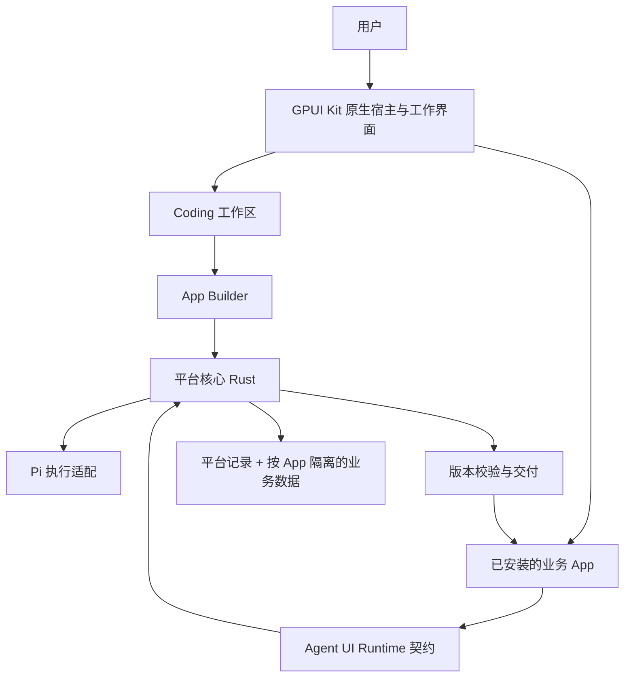

# 从 Ghostex 按需取用，独立自建平台

日期：2026-10-17（北京时间）。状态：D0 桌面可运行候选已实现并打包；gpui-shell 动态 App 留在 D1。[验收记录](../verification/d0/README.md) 区分已验证与待验收行为，[来源记录](../../THIRD_PARTY.md) 列出实际提取范围。

用户方向：只取 Ghostex 对本项目有用的部分，独立建设 Generative App Platform；桌面宿主与原生界面采用 [GPUI Kit](https://gpui-kit.com/)，首期支持 macOS。初版完整保留 Ghostex 的界面，右侧仅 Files/Terminal，只建设桌面代码，设置只留最小必要项。布局基准、4 项设置、源码裁剪映射与验收要求见 [桌面初版规格](./desktop-mvp-ui-and-code-scope.md)。

本方案依据现有 [平台概念](../concepts/generative-app-platform.md)、[Generative App 定义](../concepts/generative-app.md) 和 [Agent-native 定义](../concepts/agent-native.md)。2026-10-17 用户明确选定 GPUI Kit：当前基线为 **GPUI Kit 原生宿主 + Rust 平台核心 + Pi 执行接入**，取代此前 Electron + Node utility process 平台 Runtime 的方案。Pi 自身所需的运行环境单独管理；App 动态承载、安装更新与权限的细化设计见 [架构方案](./generative-app-platform-architecture.md)，本文件聚焦 Ghostex 取用范围。

源码基线：[maddada/Ghostex @ 05c27ecc77d738ad853f2db0d574bffa02a23a77](https://github.com/maddada/Ghostex/tree/05c27ecc77d738ad853f2db0d574bffa02a23a77)。详细证据见 [源码调研](../research/ghostex.md)。

## 1. 取用策略

Ghostex 的原生桌面呈现是当前初版的直接取用重点：优先提取并适配侧栏、聊天区、标题栏、Files/Terminal 与必要表单，保留其外观和交互。Agent 会话接入、状态维护、进程恢复和核心逻辑分离则按本项目契约重建。平台继续以自己的 App、AppVersion、AppChange、业务数据和 Action 为中心建模。

选择顺序是：先确认产品需要，再确定自己的 Interface，最后选择借鉴实现还是提取代码。依赖少只能说明模块容易移动，不能说明其语义适合本项目。

| 部分 | 源码入口 | 本项目的处理建议 | 原因 |
|---|---|---|---|
| 纯逻辑核心 + 外部执行 Effects | `packages/gx-chat-core/src/core.rs`、`effect.rs` | 优先借鉴设计，按本项目需求实现 | 核心接收事件，宿主执行 I/O；平台可共享逻辑而不绑定某个界面 |
| Agent 事件和消息归一化 | `server/src/session_chat_decode_pi.rs`、`packages/gx-protocol/src/chat.rs` | 参考消息分块、工具调用关联和错误展示，定义自己的事件 | Ghostex 类型包含其自身的会话和展示约定 |
| Agent 会话恢复和生命周期 | `server/src/agents/`、`server/src/session_chat_send/` | 阅读问题处理经验；首期只接 Pi | 多 Agent 的终端兼容逻辑会扩大维护范围 |
| 子进程管理 | `server/src/extensions/process.rs` | 参考 readiness、超时、generation、退出回收；独立实现 | 其 Implementation 依赖 Ghostex 扩展状态、配置、协议和进程工具 |
| 草稿、发送队列、请求记录 | `server/src/session_chat_queue.rs`、`server/src/storage/migrations/` | 参考持久化方式；平台自己规定接纳、重试和恢复语义 | 排队发送、Agent 执行和业务提交是不同结果 |
| `gx-visual` | `packages/gx-visual/` | 有明确聊天图表需求时再评估提取 | 依赖少，能输出场景/SVG；不负责完整生成 App |
| `gx-protocol` | `packages/gx-protocol/` | 参考兼容性处理；首期不整包采用 | 易移动，但协议仍然指向 gxserver |
| `gx-chat-core` | `packages/gx-chat-core/` | 首期不整包采用 | 它是聊天状态与展示核心，不是 Pi 执行引擎；范围远大于最小聊天能力 |
| `gx-core`、客户端存储 | `packages/gx-core/`、`packages/client-storage-native/` | 参考组织方式，重建产品模型和存储 | 带有 Ghostex 项目/侧栏/设置模型和历史存储迁移 |
| 原生桌面外壳、侧栏与聊天 | `apps/desktop/src/app/native_sidebar/`、`native_chat/`、`render/` | 优先提取呈现与交互，适配 GPUI Kit 和本地模型 | 用户已明确要求保留 Ghostex 界面；不继承其全量 store/RPC |
| 文件树与文件预览 | `apps/desktop/src/app/native_docs/` | 提取只读部分；保留左预览、右文件树 | 不引入文档编辑、批注或内嵌浏览器 |
| 原生终端 | `terminal_model.rs`、`terminal_element.rs`、`ghostty_vt/` | 优先验证 PTY/VT 与渲染移植，保留必要原生依赖 | 终端是首期必需功能；不复制整套 Ghostty/zmx/远程恢复链 |
| 原生设置 | `apps/desktop/src/app/window/` | 提取表单风格与行为，重建最小设置 | 仅主题、UI 缩放、Pi 路径、Shell 路径可编辑 |
| CEF、Browser、IDE、其他工具视图 | `apps/desktop/` 中相关分支、`.dependencies/` 中相关项目 | 从视图注册、菜单、依赖到打包一起裁掉 | 初版右侧类型白名单只有 Files/Terminal |
| 手机、Web、远程接入、团队协作、多账号 | `apps/mobile/` 等 | 不进入本次桌面工程 | 仅交付桌面端，不维护配套服务与其他客户端 |

本次在固定源码中统计 `src/**/*.rs` 的物理行数（包含注释与测试）：`gx-chat-core` 256 个文件、64,504 行；`gx-core` 195 个文件、47,448 行。它们虽已独立成 crate，仍承载大量 Ghostex 产品行为。数字用于说明提取规模，不是质量或复杂度评分；本次未编译验证这些 crate。

证据：[ChatCore](https://github.com/maddada/Ghostex/blob/05c27ecc77d738ad853f2db0d574bffa02a23a77/packages/gx-chat-core/src/core.rs)、[协议契约](https://github.com/maddada/Ghostex/blob/05c27ecc77d738ad853f2db0d574bffa02a23a77/packages/gx-protocol/src/lib.rs)、[Pi 解码器](https://github.com/maddada/Ghostex/blob/05c27ecc77d738ad853f2db0d574bffa02a23a77/server/src/session_chat_decode_pi.rs)、[进程管理](https://github.com/maddada/Ghostex/blob/05c27ecc77d738ad853f2db0d574bffa02a23a77/server/src/extensions/process.rs)、[visual crate](https://github.com/maddada/Ghostex/blob/05c27ecc77d738ad853f2db0d574bffa02a23a77/packages/gx-visual/Cargo.toml)、[客户端存储依赖](https://github.com/maddada/Ghostex/blob/05c27ecc77d738ad853f2db0d574bffa02a23a77/packages/client-storage-native/Cargo.toml)。

## 2. 独立平台的最小架构

先完成 D0 原生 Coding 工作区；下图是后续加入动态 App 的目标结构，不要求桌面初版同时实现全部模块。



模块 Interface 应隐藏需要共同成立的规则，避免让每个界面重复处理状态、持久化、版本检查和恢复。

| Module | 对调用方提供的 Interface | 内部负责的行为 |
|---|---|---|
| App Catalog | 查看 App、版本与当前有效版本 | 稳定身份、管理状态、来源、版本索引；不混入聊天会话身份 |
| App Delivery | 建立变更、校验候选、预览、安装 | 草稿与已安装产物分开；授权、兼容、迁移检查；原子切换版本及交付记录 |
| Task Runtime | 接纳任务、观察、取消、恢复 | 固定 ContextSnapshot、关联 Session/Run、持久任务状态、断连恢复 |
| Action Runtime | 发现能力、执行动作、查询结果 | 可信授权范围、revision 前置条件、幂等键、原子提交及 Operation 证据 |
| App Host | 打开指定 App/版本、关闭实例 | 前端入口、运行资源、预览数据范围、实例身份、后端生命周期 |
| Agent 接入 | 启动/恢复执行、提交输入、消费事件、中断 | 先做一个具体 Pi Implementation；出现第二个引擎后再提炼共享 Adapter Interface |

GPUI Kit 宿主负责窗口、原生输入、布局与交互；Rust 平台核心负责 App、任务、授权、交付与存储。初期这些逻辑模块可随宿主在同一 Rust 进程内运行，用 SQLite 保存平台元数据；耗时 I/O 和 Pi 子进程管理不阻塞 UI 线程。无需为每个模块立刻创建 crate、微服务或通用插件体系，是否分离平台 Runtime 进程由恢复与隔离需求验证。

App 业务数据有自己的命名空间和迁移规则。平台元数据库可以共享存储引擎，但不能因为物理共库就允许任意 App 访问其他 App 的数据。

D0 已按能力在一个桌面 crate 内实现；下图中的后续平台模块仍是规划。同一能力的模型、视图、命令与适配放在一起，有独立复用需求后再拆共享 crate：

```text
apps/desktop/src/          # D0
  shell/                   # 窗口、主题、菜单、两类面板组合
  workspace/               # 项目/会话/消息/composer 与 Pi 具体接入
  files/                   # 文件树、只读预览与文件监听
  terminal/                # 原生终端、PTY/VT 与进程管理
  settings/                # 最小配置、校验与原生表单
  storage/                 # SQLite 基础设施
runtime/src/               # D1 增量模块，需要共享时再提取
  apps/                    # App Catalog 与交付
  tasks/                   # 任务、上下文与运行记录
  actions/                 # 业务能力与结果
  host/                    # 动态 App 托管
packages/
  app-sdk/                 # 生成 App 接入契约
examples/
  article-workspace/       # 第二个 App，先验证草稿管理
```

## 3. Pi 接入：直接连接官方能力

Ghostex 的 Pi 消息解析经 `crate::session_chat::*` 使用服务端共享类型，其阻塞检测还需要读取终端界面。对拥有自己界面和 Runtime 的平台，官方机器接口更符合需求，能减少终端呈现变化带来的兼容工作。

Pi 官方提供长期子进程 RPC：通过 stdin/stdout 交换 JSONL 命令、响应和事件；也提供 Node/Bun 进程内 SDK。Rust 主 Runtime 可先验证 RPC，自定义工具可通过 Pi 子进程内的 TypeScript 扩展接入；若选择 SDK，则由 Node/Bun worker 承载。两条路径的产品规则都由 Rust Runtime 的业务动作入口执行。这里核对的 Pi 源码版本为 `698a2d23b86a5045dd54554354a5e0cb7e466795`。[Pi RPC](https://github.com/earendil-works/pi/blob/698a2d23b86a5045dd54554354a5e0cb7e466795/packages/coding-agent/docs/rpc.md)、[Pi SDK](https://github.com/earendil-works/pi/blob/698a2d23b86a5045dd54554354a5e0cb7e466795/packages/coding-agent/docs/sdk.md)、[Pi 扩展](https://github.com/earendil-works/pi/blob/698a2d23b86a5045dd54554354a5e0cb7e466795/packages/coding-agent/docs/extensions.md)。

具体约束：

- 把命令接纳、Agent 停止、平台任务完成、App 交付成功分别记录。模型说“完成”不能直接切换已安装版本。
- 平台 Session ID 与 Pi session reference 显式关联；恢复原会话不重放已经产生副作用的用户请求。
- 事件先转为平台自己需要的消息、工具调用、输入请求、运行状态；保留引擎原始引用供诊断，不让前端依赖 Ghostex 协议。
- 子进程断开后先恢复或核对事实。发送结果未知时展示未知状态，不能把重新发送当作恢复。
- 配置、会话路径、引擎版本、自动资源发现和扩展加载都由平台明确管理，实际命令以锁定版本验证。

工具限制不等于执行隔离。Coding 任务可在用户选择的候选工程内运行；`cwd` 本身不能阻止文件工具或 shell 访问其他路径。已安装业务 App 的文章操作应调用平台绑定文章范围的 Action，不应获得用于构建代码的整套文件和 shell 权限。是否用 RPC 扩展还是 SDK worker 实现自定义工具，需要做真实接入验证。[Pi 安全说明](https://github.com/earendil-works/pi/blob/698a2d23b86a5045dd54554354a5e0cb7e466795/packages/coding-agent/docs/security.md)。

## 4. GPUI Kit 宿主与 App 承载

### 已确定的桌面技术基线

平台使用 GPUI Kit 构建原生 Rust 桌面应用，并保留 Ghostex 的初版界面。官方入口 crate `gpui-kit` 整合 GPUI、GPUI Base 与 GPUI Component；具体版本和 feature 在工程初始化时锁定。迁入代码统一使用同一 GPUI 依赖谱系，不混入 Ghostex 旧的 Zed git 依赖。[官方入门](https://gpui-kit.com/docs/getting-started/)。

| 层次 | 在本项目中的位置 |
|---|---|
| GPUI | 原生窗口、元素模型与渲染基础 |
| GPUI Kit / `gpui-kit` | 桌面应用的集成入口与界面技术基线 |
| GPUI Component / `gpui-component` | 平台原生控件与统一视觉体系的优先来源 |
| GPUI Base / `gpui-base` | 需要自定义界面时复用交互、焦点、状态和可访问性基础 |
| gpui-shell（条件采用） | 动态 App 的 JavaScript 界面与原生渲染；通过受控加载与平台 HostModule 接入 |
| Rust 平台核心 | App、任务、业务动作、存储、版本交付与恢复 |
| Pi RPC 子进程 | Agent 执行与模型会话，通过平台自己的 Interface 接入 |

`gpui-component` 基于 `gpui-base`；选择 GPUI Kit 不要求从零实现所有控件。原生控件和自定义界面共享平台的语义状态与业务动作入口。[官方分层说明](https://gpui-kit.com/base/)。GPUI 的 UI Action 与平台业务 Action 分别承担输入命令分发和受授权的业务执行，不能以触发界面命令代替业务结果确认。

### 生成 App：优先验证 gpui-shell

根据 [固定版本源码调研](../research/gpui-shell.md)，推荐以 gpui-shell 的 JavaScript ES modules 作为首期动态 App 界面产物。当前源码已包含 `gpui-component` 脚本绑定，可同时使用原生样式控件、自有组件和 Base 组合界面。它仍是实验性接口，需锁定完整 commit；不能直接执行 React DOM 页面，也不等同于动态加载 Rust 后端。

平台自建 Shell App Host：每 AppInstance 独立 VM / Policy / HostModule，补齐从模块求值开始绑定显式 Policy 的公共加载入口。正式安装保存不可变 AppVersion；更新通过独立预览、新 VM 挂载、业务写入协调和版本切换交付，不使用 `watch` 热重载代替安装事务。

首期 profile 显式关闭 Shell 的默认 WebView feature，不授予生成界面通用进程执行或生产数据路径。原生组件、默认环境与资源预算的具体限制及 G1–G6 验收条件见 [完整架构](./generative-app-platform-architecture.md)。完成验证前只作条件采用建议，不声明已提供可靠隔离与升级。

编译交付 Rust App 保留为后续备选，不与首期动态承载并行建设。Web 内容与外部应用预览按实际需求独立评估；App 身份、版本、业务数据和授权始终由平台契约管理。

## 5. 首个可交付闭环

沿用现有产品顺序：内置 Coding 工作区，然后通过它创建第二个自媒体 App。**D0 先交付保留 Ghostex 界面的桌面基线**，连通真实 Pi、只读文件预览、本地终端和本地持久化，按 [桌面规格](./desktop-mvp-ui-and-code-scope.md#8-后续实现验收要求) 验收。

以下为 **D1 首个动态 App 闭环**：只承诺文章草稿管理，外部发布后续再做。其原型关口不阻塞 D0；动态 App 的导航与挂载位置单独细化，不预先增加右侧第三类工具。

1. 用户在 Coding 工作区提出“创建文章草稿工作台”，平台建立 App 与 AppChange，记录需求和基线。
2. Pi 在候选工程生成符合已验证承载类型的界面与业务动作，调用共享 SDK；生成过程不直接改写已安装产物。
3. 平台校验 Manifest、构建结果、动作声明和数据兼容性；保存不可变候选版本及验证证据。
4. 用户预览候选，使用独立预览数据。验证或预览失败保留明确失败记录。
5. 安装通过的候选，写入交付记录并切换 `currentVersionId`；用户可以关闭并重新打开同一 App。
6. 创建文章并保存。App 数据属于稳定 App 身份，不存放在临时候选源码目录。
7. 用户提出“增加标签筛选”，形成新的 AppChange 和候选版本；新版本交付后原文章仍存在。
8. 对不兼容变更返回迁移要求；交付失败时当前有效版本仍可使用。代码回退不承诺自动还原业务数据。

首期验收应覆盖：重启后恢复、候选与正式版本并存、保留业务数据的更新、失败交付、并发基线冲突、权限范围和请求重试。先验证显式 Policy / HostModule 与原生挂载接入，再建立 App Catalog + App Delivery 的纵向闭环并连接 Pi；首个升级只支持同业务 schema，迁移机制完成前拒绝需要迁移的候选。

## 6. 代码提取时记录什么

真正需要复制上游代码时，按模块提取，记录仓库、完整 commit SHA、原路径、所含文件、对应许可与本地修改。保留独立的来源目录和变更记录，便于后续比较上游。

Ghostex 根目录提供 MIT 许可；复制其代码需随复制范围保留对应许可文本。`.dependencies/` 中外部项目与资产另行核对，不把根目录许可套到整条依赖链。[固定版本 LICENSE](https://github.com/maddada/Ghostex/blob/05c27ecc77d738ad853f2db0d574bffa02a23a77/LICENSE)、[子模块清单](https://github.com/maddada/Ghostex/blob/05c27ecc77d738ad853f2db0d574bffa02a23a77/.gitmodules)。

已实际提取 VT 包装、适配 PTY 模型与原生渲染，并参考既定界面用 GPUI Kit 重建桌面呈现；具体文件、构建修改和许可见 [来源记录](../../THIRD_PARTY.md)。`gx-visual` 保留为明确出现图表需求时的候选。D0 的编译、启动和数据目录独立于 Ghostex；会话、存储、Pi 与 PTY 是桌面本地模块，不依赖 gxserver 或远程 daemon。

## 7. 本次完成与待验证项

已完成：读取现有三份概念文档；固定 Ghostex 源码版本；核对候选 crate 的依赖、关键 Interface 和 Pi 接入；记录 GPUI Kit 桌面选型；完成 gpui-shell 静态调研与 [App 运行架构](./generative-app-platform-architecture.md)；归档用户截图，新增 [桌面界面与代码裁剪规格](./desktop-mvp-ui-and-code-scope.md)，明确 D0 → D1 顺序。

实施进展：已建立 Cargo workspace、固定 Kit 与 Cargo.lock、通过 VT 静态库和桌面构建、接入 SQLite/Files/真实 PTY/真实 Pi RPC/最小设置，并生成原生截图和未签名 `.app`。具体测试、人工验收缺口以 [D0 验收记录](../verification/d0/README.md) 为准。动态 App Host、安装/更新闭环与 G1–G6 尚未实现。
