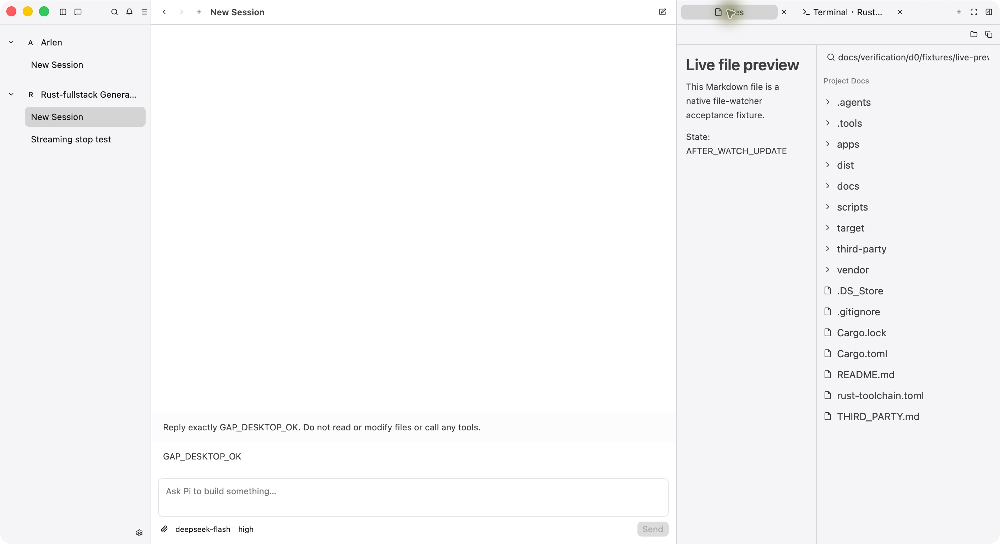
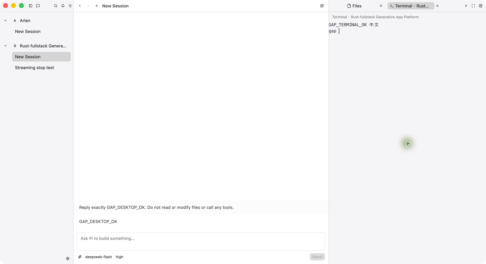

# D0 桌面实现与验收记录

日期：2026-10-17（北京时间）。状态：**可运行的 D0 候选已交付，尚有人工验收项未通过**。动态 App、gpui-shell、安装/更新、签名与公证不在本轮产物中。

## 产物与环境

- 应用包：`dist/Generative App Platform.app`，可直接在当前机器打开；arm64、未签名开发构建。重建见 [根 README](../../../README.md)。
- macOS 26.5.1，macOS SDK 26.5，Rust 1.95.0，项目本地 Zig 0.16.0，Pi 0.85.1。
- GPUI Kit 固定 `eec1208dd57d8bc8abc769fd833d181d297790f9`。正常依赖树为 GPUI pre 0.3.9 同一谱系；没有 CEF/WebView、Ghostex 服务端或远程 daemon。
- VT 与 SQLite 静态链接；产物仅依赖 macOS 系统库和框架。Pi、Shell 使用本机安装，不复制凭据。
- 原生截图为 1408 × 768 逻辑视口、2x 像素。初始三栏宽度 424/528/456，Files 内部 190/250；活动截图包含验证时保存的拖拽布局，不能据此重新定义初始比例。

## 实现范围

| 能力 | 已接入的实现 |
| --- | --- |
| 桌面外壳 | 单 Root；项目/会话侧栏、聊天、标题、Files/Terminal 标签；拖拽、收起、最大化、布局存储；窄窗口依次收起右侧和侧栏 |
| Pi | 每会话独立 RPC 进程、显式 session 文件和 cwd；请求关联、流式消息/思考/工具结果、模型/推理级别、停止；选择/确认/输入/编辑 Extension UI；切换会话保留进程 |
| 恢复 | SQLite 项目/会话映射/消息投影/草稿/选择/设置/布局；重新查询 Pi 历史与状态，不自动重发结果未知请求；写入按提交顺序入队 |
| Files | 左预览/右文件树；后台读取及结果失效；只读代码、Markdown、图片、HTML/JS 源码；路径定位/搜索、已加载目录和文件监听、复制路径、Finder/系统打开 |
| Terminal | 项目本地 Zig 构建 VT；真实 PTY、原生网格渲染、UTF-8/IME 输入接口、选择/粘贴、滚动、resize、多终端；隐藏不终止；关闭/退出确认终止 |
| Settings | 主题、UI 缩放、Pi 路径、Shell 路径四项；路径与数据目录只读信息；失败保留输入和有效配置，路径影响新进程 |

Files 预览限制 8 MiB、图片 40 MP。终端重启恢复的是布局和项目目录，并创建新 PTY，不恢复原 shell。上游完整界面的像素级一致性和所有高级终端行为均未作穷尽性声明。

## 自动化与构建

最终代码通过 `cargo fmt --all -- --check`、`cargo clippy -p generative-app-desktop --all-targets --locked -- -D warnings`、`cargo test -p generative-app-desktop --locked` 和本地 `.app` 打包。工具与会话稳定性修订后为 **31 项测试通过，0 失败**（读取文件崩溃修订 27 项）。

| 测试范围 | 验证内容 |
| --- | --- |
| JSONL/RPC | 单字节分片、分裂 UTF-8、CRLF、U+2028；乱序 response、未知 ID、超时请求不重发 |
| 会话恢复 | 恢复投影不恢复运行标记，保留草稿；原生重启再从 Pi 核对历史 |
| 存储/布局 | 完成 future 逆序等待仍按提交顺序写入；重开读回；面板宽度、可见性、终端项目身份和旧布局默认值 |
| 文件 | HTML 显示源码、项目外符号链接拒绝读取；快速项目/文件切换不覆盖当前预览；真实生产 Editor 拒绝编辑 |
| 终端 | 真实 `/bin/sh` 输出、resize、退出码；关闭运行 shell 后终止并回收 PID |
| 生产 UI | 原生项目 picker、项目/会话切换、草稿立即切换保留、两类标签切换；生产分隔条拖拽、设置弹窗及关闭后的焦点恢复 |
| 设置失败 | 真实表单触发路径校验失败及 SQLite 提交失败；输入保留、上一有效配置不变 |
| 会话管理 | 生产菜单归档/只读查看/恢复、删除取消和确认、草稿保留、SQLite 重开；提交失败保留记录；删除等待迟到的真实 Pi 子进程返回并终止/回收，不处理删除中的事件 |
| 固定面板开关 | 生产 Desktop 控件点击，100%/125%/150% 下分别验证四种展开组合；比较完整 bounds；700 逻辑像素窄窗口自动隐藏后仍保持窗口边缘定位 |

构建与测试输出保存在 [logs](logs/)。脚本通过 `bash -n` 检查。没有修改第三方 VT 算法，因此没有运行完整 Ghostty 桌面测试套件。

## 原生窗口验证

使用实际 `.app` 和生产视图完成下列检查；未以模拟聊天或文本日志替代终端。

| 流程 | 观察结果 |
| --- | --- |
| 打开项目、切换、新建/重命名会话 | 当前工程正常打开；切换保留历史；`Streaming stop test` 重命名成功 |
| 真实 Pi 回复 | 当前本机模型返回 `GAP_DESKTOP_OK`；重启后历史仍在，没有自动重发 |
| 真实文件工具 | Pi `read` 读取 fixture，工具结果在聊天中可展开，包含 `AFTER_WATCH_UPDATE`；结果投影及 Pi JSONL 均保留 |
| 流式与停止 | 长回复持续增长，Stop 后变为 `Stopped`，保留已接收内容；取消完成取决于 Pi/provider 响应，不以按钮点击当作完成 |
| Files | `Cargo.toml` 语法高亮；Markdown 渲染；修改 fixture 后标记从 `BEFORE_WATCH_UPDATE` 自动变为 `AFTER_WATCH_UPDATE` |
| 真实终端 | 执行 `printf`，显示 `GAP_TERMINAL_OK 中文`；粘贴和 UTF-8 输出正常；重启后 shell 是新进程 |
| 退出 | 活动终端存在时触发 Quit 确认；确认后应用关闭，历史及布局可恢复 |
| 主题/缩放 | 浅/深色 × 100%/125%/150% 均切换并保存截图；125% 标签关闭按钮完整可见，150% 在当前窗口自动收起右侧；设置表单可用 |





设置截图：[浅色 100%](assets/settings-light-100.png)、[125%](assets/settings-light-125.png)、[150%](assets/settings-light-150.png)；[深色 100%](assets/settings-dark-100.png)、[125%](assets/settings-dark-125.png)、[150%](assets/settings-dark-150.png)。[停止状态](assets/pi-stopped.png) 沿用此前同轮原生验证截图。

[真实 Pi 文件工具结果](assets/pi-file-tool.png) 展示独立于预览读取的 Pi 工具输出；该轮只确认工具结果，不将其等同于完整助手最终回答已完成。

独立截图评审依据 Oil UI 的存量界面核对流程完成。发现并修复 125% 标签硬裁切、Pi/数据路径信息缺失、设置选项与保存按钮对齐问题；修正后复查无剩余必要修正。评审仅涵盖静态画面，不据此声明交互或动效通过。

## 会话管理与面板开关修订

根据后续用户反馈，增加常驻会话 `…` 菜单和项目内 `Archived` 分组；窗口级控件取代面板内部的关闭/恢复按钮。初始回归测试在收起侧栏后测得按钮 x 从 80 移至 369 逻辑像素；修订后完整 bounds 在面板切换前后相同。macOS 窗口按钮的 80 逻辑像素保留区为平台几何边界，按钮尺寸、间距和高度继续响应 UI 缩放。

实际 `.app` 中新建 `Session actions verification`，验证归档、只读查看、恢复、删除确认与取消；再次归档并退出重开，记录仍在。最终保留这一归档验证会话，未通过原生 GUI 永久删除已有会话。确认删除和进程回收由隔离临时目录中的生产 UI/真实子进程测试覆盖，没有调用模型发送额外测试聊天。

修订后的原生截图：

- [会话菜单](assets/session-actions-menu.png)、[归档状态](assets/session-archived.png)、[删除确认](assets/session-delete-confirmation.png)、[重启后归档保留](assets/session-archive-restored-on-relaunch.png)。
- [面板展开](assets/panel-toggles-expanded.png)、[面板全部收起](assets/panel-toggles-collapsed.png)：两个开关分别留在窗口左、右边缘。
- [深色 125%](assets/panel-toggles-dark-125.png)、[深色 150%](assets/panel-toggles-dark-150.png)：150% 自动收起右侧后开关仍可见。验证后恢复原来的 Light／100%。

本轮日志使用 `logs/session-panel-*` 前缀，包括修订前失败回归、最终 18 项测试、Clippy、格式检查及重新打包。SQLite 删除失败保留会话和历史；若只有历史文件清理失败，显示单独错误，不报告完全清理成功。退出等待已提交的归档/删除结束，再关闭进程与刷新数据库。

## 项目层级、项目删除与输入建议修订

后续反馈对应实现如下：

- 项目采用文件夹图标、加粗名称和目录路径；会话采用缩进的聊天行。项目菜单常驻，完整名称与路径可从提示和删除确认中核对。
- `Delete Project…` 确认范围包括普通/归档会话、本地 Pi 历史及对应进程和终端；磁盘目录与项目文件保留。SQLite 事务失败时项目和会话全部保留；成功后释放文件与终端状态。
- `/` 提供六个桌面命令和 Pi `get_commands` 返回的扩展/提示模板/技能。`@` 后台搜索当前项目文件，选择后加入文本引用及现有附件；带空格的路径自动加引号。↑↓、Home/End、Enter/Tab、Esc 有明确行为，选择建议不会直接发送。

新增自动化覆盖生产项目菜单取消/确认、删除后重开数据库、保留项目文件和其他项目、关闭项目终端、事务失败回滚及 UI 状态保留；生产输入框的键盘补全、本地重命名、设置命令、带空格文件引用、项目切换使过期查询失效；UTF-8 光标/邮箱边界、跳过符号链接和构建目录；Pi 命令目录经请求关联进入真实 RPC 通道，未知命令不会回退到模型提示，已处理的扩展命令不会留下持续 Stop 状态。UI 自动化按 Kit 约定启用 reduced motion，避免在弹窗进入动画中点击移动目标；生产动画保留。

实际 `.app` 中使用独立会话 `Project and composer verification`，完成 `/` 弹出、方向键/Tab 插入、`/rename` 执行、`@README` 搜索和 Enter 插入、附件显示，以及项目删除确认和 Esc 取消。Pi 返回的 `/llama` 和 `/skill:…` 已出现在原生建议列表；未执行这些扩展或发送新的模型请求。未在用户数据中确认删除项目，确认删除由临时目录中的生产 UI 测试覆盖。

原生截图：[项目与会话层级](assets/project-session-hierarchy.png)、[项目删除确认](assets/project-delete-confirmation.png)、[/ 命令建议](assets/composer-slash-commands.png)、[@ 文件建议](assets/composer-file-suggestions.png)、[引用与附件](assets/composer-file-attached.png)。修正过一次建议行的图标竖排与可访问名称；最终原生列表已横向对齐并公开命令/文件名称。截图为当前用户的深色主题，未更改其主题和分隔比例。

本轮最终日志使用 `logs/project-composer-*` 前缀。搜索最多遍历 20,000 条目并返回 80 个结果，不读取文件内容；跳过的目录和完整交互说明见 [运行说明](../../../README.md)。完整 Pi TUI 命令集、跨项目引用和 Agent 提及不在本轮范围；中文输入法的候选交互仍沿用下列人工验收缺口，不能由 UTF-8 和组合输入保护代码推定已通过。

## 读取文件后崩溃修订

2026-10-17 用户报告让 Pi 读取 README 后应用退出。所附 macOS 报告指向 `A11yNodeBuilder::can_push`。实际原因是客户端将 `tool_execution_start` 与随后同一 `toolCallId` 的 `message_start(toolResult)` 各追加为一行，产生重复元素 ID；无障碍树启用时触发 `Duplicate a11y node id` 断言并中止进程。Pi 0.85.1 本地 `pi-agent-core/dist/agent-loop.js` 的 `emitToolExecutionEnd`、`emitToolResultMessage` 确认这一事件顺序。

修复将消息开始、结束和工具开始统一为按稳定 ID 更新或插入，保留已有文件链接；移除按相同角色替换消息的回退。SQLite 投影加载和 RPC `get_messages` 同步均合并重复行，保留最后内容和可用的文件链接；恢复不重发提示。没有关闭无障碍功能或移除 GPUI 的断言。

最小回归命令：

```sh
cargo test -p generative-app-desktop --locked read_tool_events_keep_one_accessible_message_row -- --nocapture
```

修复前该测试在工具结果的 `message_start` 后失败（4 行、3 个唯一 ID）。最终回归通过真实 Workspace 逐事件回放两个交错的文件工具调用、部分结果、重复结束事件和后续流式回复；每帧校验身份唯一，操作生产工具结果按钮，核对两份结果及其文件链接。另一项测试从 SQLite 加载旧重复投影，核对合并结果、文件链接、草稿保留及未开始运行的状态。headless 测试不代替系统无障碍树验证。

原生验证使用独立临时数据目录、合成 RPC 回放进程和相同生产二进制：旧版在真实 macOS 窗口启用无障碍树后复现同一断言；新版完成相同事件顺序、工具结果展开、中文内容显示、重启恢复和点击结果中的 README 文件链接预览。[原生截图](assets/read-tool-crash-fixed.png)展示重启后的结果与 Markdown 预览。回放不调用模型。临时回放应用已退出并清理；随后打开正常 `.app`，原崩溃会话从真实 Pi 恢复工具结果，未重新发送提示。

记录见 `logs/read-crash-*`，包括修复前失败回归、旧版原生断言、最终 27 项测试、Clippy、格式及打包输出。修复版二进制 SHA-256：`6a96127219fe13c1bd8205ed3d514f75c05c295f58b51b909ecee3a50a46b868`。

## 工具调用与会话切换稳定性修订

扩大检查后，新增回归测试首先复现两个问题：最终 `toolResult` 覆盖执行中消息时丢失工具名称和失败标记；展开状态只按消息 ID 保存，两个会话拥有相同 ID 时会共享展开状态。修复后 `Message` 持久化工具名称与失败标记，旧 JSON 记录兼容缺省字段；按会话和消息联合身份保存展开状态并命名聊天容器。点击展开会使对应行重新测量，删除会话清理其展开缓存。相对文件链接在渲染时绑定消息所属项目，不借用回调执行时的其他项目。

新增四项自动化使用生产 Workspace、Sidebar、输入框、工具结果按钮和会话切换处理器：

- 连续三个 `read`、`write`、`edit`、`bash`、自定义工具的执行、部分结果及最终结果；每帧核对消息身份唯一，命令失败结果保持 `bash · Error`。
- 两个会话使用相同消息/工具 ID，交错输出并切换 12 次；草稿、内容、展开状态、运行状态和进程归属独立，切换不发送 prompt、abort 或重启请求。
- A 发送后切到 B 修改草稿，延迟到达的 A 确认不能清空 B；切回 A 点击 Stop，只向 A 发送 `clear_queue`、`abort`。
- 后台会话 RPC 历史同步合并重复工具行，保留失败标记和文件链接，不污染当前会话或重发请求。

原生系统无障碍树验证使用[本地 RPC 回放工具](fixtures/pi-tool-stability.py)和两个临时项目。每个进程实际读取三份 Markdown 文件并启动固定的 `/bin/sh` 命令：A 在后台完成中文输出并以 17 退出，B 的 30 秒长命令由 Stop 终止、等待回收。切换期间 A 正常完成，B 继续运行；结果均只有三个 read 和一个 bash 行。A 的失败和 B 的停止均保持可展开的错误状态。跨项目同名 `one.md` 分别显示 A/B 内容；相同 ID 的思考展开状态互不影响。退出重开后错误标记、工具结果、文件链接和预览恢复，两份引擎记录仍各只有一次用户发送。未调用真实模型，不能由此推定所有 provider/extension 组合均已完成验收。

截图：[停止后的命令](assets/tool-stability-stopped.png)、[项目 A 的同名文件](assets/tool-stability-project-a.png)、[项目 B 的同名文件](assets/tool-stability-project-b.png)、[重启恢复](assets/tool-stability-restored.png)。日志使用 `logs/tool-audit-*` 前缀，包含修复前失败测试、31 项完整测试、Clippy、格式、打包和原生核对记录。回放进程及临时数据已清理，回放脚本作为可重复验证夹具保留。

本轮打包二进制 SHA-256：`33ec6e29d3fa854193b1d35a483dfdd8352a59f031614866035424493353ae91`。Git 首次提交纳入应用源码、锁文件、固定第三方源码及验收资料；`target/`、`.tools/`、`dist/`、Python 缓存及应用用户数据不纳入版本控制。

## 尚未通过的验收项

以下仍需后续人工或专门环境验证，不能从现有测试推定通过：

1. macOS 中文输入法的真实组合输入、候选窗定位、取消组合与连续切换焦点。当前只确认原生输入接口和中文 UTF-8 粘贴/输出，不能代替此项。
2. 多种交互式 TUI、alternate screen、鼠标报告、长滚动回放、跨行选择复制和后台作业的完整终止矩阵；未声明与 Ghostex/完整 Ghostty 全量行为等价。
3. 使用真实 Pi extension 覆盖全部 Extension UI 确认、取消、超时及同时请求场景；接口已实现，尚未做现场矩阵验收。
4. 更多 provider、真实断网/异常退出期间的未知发送结果恢复、长时间会话负载、超长可执行路径的完整视觉矩阵，以及新 macOS 用户环境的冷启动。

本机工程构建与已列出的核心流程可用；以上项目保留为 D0 验收缺口，D1 另按 [动态 App 架构关口](../../design/generative-app-platform-architecture.md) 执行。
